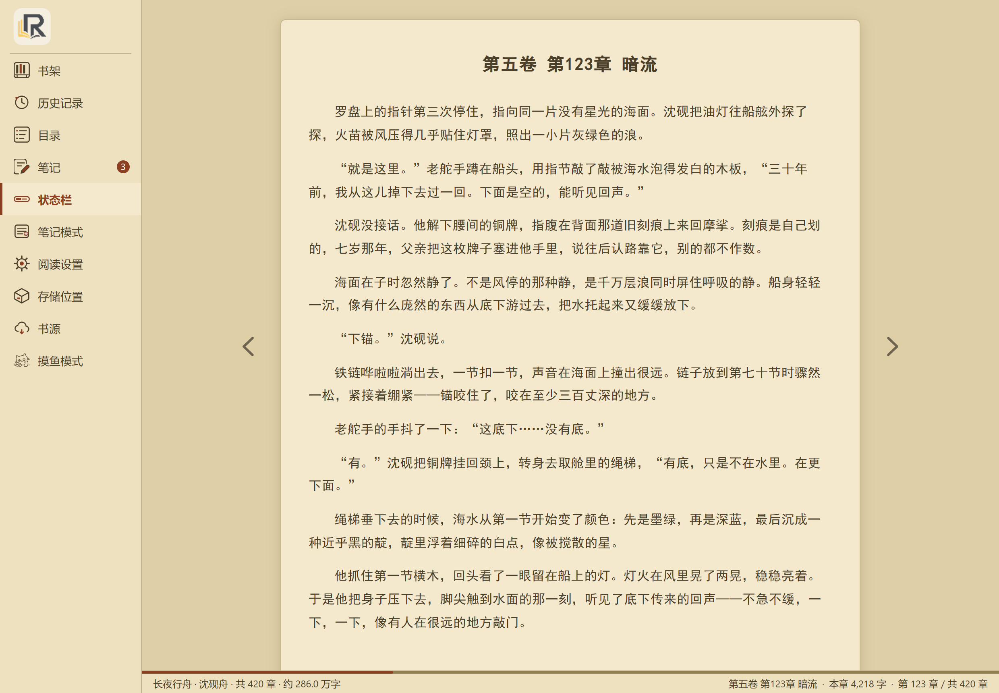
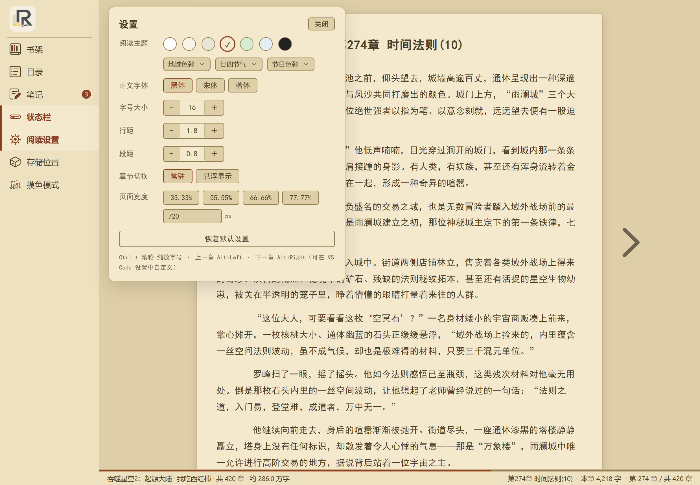
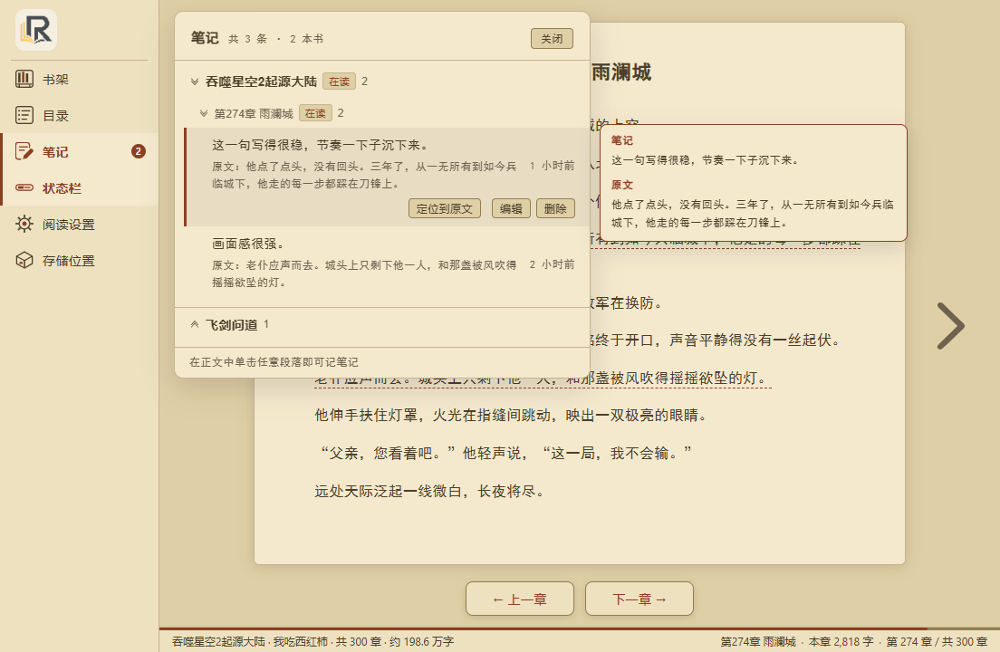

# 小说阅读器 · Novel Reader

在 VS Code 里读小说：导入本地 `.txt` 文件，自动解析章节目录，提供**我的书架**与沉浸式阅读界面。

**全部本地运行**——不联网、不上传文件、不内置任何小说内容，只读取你自己选择的文本文件。

| 项目 | 说明 |
| --- | --- |
| 插件 ID | `local.r-novel-reader` |
| 显示名称 | 小说阅读器 |
| 当前版本 | 1.42.6 |
| 要求 | VS Code 1.85.0+（实测 1.128.0），Node.js 18+（仅打包时需要） |
| 开源协议 | MIT |
| 代码仓库 | [Gitee](https://gitee.com/rich-woman-hugs-me-to-sleep/r-novel-reader)（主仓） · [GitHub](https://github.com/r-codevault/r-novel-reader)（同步镜像） |

---

## 界面一览

**整体界面**：左侧竖排菜单 + 居中正文纸面 + 底部章节导航与状态栏（羊皮纸主题）



左侧菜单提供 **书架 / 目录 / 状态栏 / 阅读设置 / 存储位置**，点击即打开对应浮层（同一时刻只开一个，点面板外或「关闭」收起）。

**书架**：多本管理、进度一目了然，「＋ 添加书籍」黏底不随列表滚动


**目录**：自动按卷分组、双列排布、当前章高亮，顶部可切正序/倒序、直接翻上/下一章


**阅读设置**：七套预设主题 + 地域色彩 / 廿四节气 / 节日色彩三类派生主题，字体、字号、行距、段距、页面宽度实时生效



---

## 特性

### 我的书架

- 打开过的小说自动登记进书架，**多本书随意切换**
- 书架底部有**黏底的「＋ 添加书籍」按钮**：书籍过多出现滚动条时按钮固定在底部，不随列表滚动
- 每本书自动记录阅读进度（读到第几章 + 章内位置），点书名即从上次位置接着读
- 条目显示「读至 第 N 章 / 共 M 章」，当前打开的书用绿色标记
- 悬停条目右侧出现 ✕ 可从书架移除（有二次确认，不会删除文件）
- **文件被移动/改名后**：打开该书会提示，可「重新选择文件」并**保留原阅读进度**，或直接从书架移除
- 上次退出时阅读页开着的话，重开 VS Code 会**原样恢复**（章节 + 章内位置）；若上次没开阅读页，启动时不会弹出阅读页，点状态栏「小说阅读」或命令 `小说阅读器: 回到当前阅读章节` 进入

### 存储位置（书库目录）

导入的文件**默认原位引用**——插件只记录路径，不复制不搬动，你放在哪里就在哪里读。

如果希望统一收纳，可在左侧菜单点「**存储位置**」→「**选择书库目录**」：

- **默认不设置**：直接读取导入文件的原始路径
- **设置后**：导入小说时**自动复制一份到书库目录**，之后从副本读取，原文件可以自行移动或删除
- 同名文件不会覆盖：大小相同视为同一份直接复用；内容不同则自动改名为 `书名 (1).txt`
- 源文件已在书库目录内时不再重复复制
- 支持「在文件管理器中打开」与「使用原路径（不拷贝）」一键还原

> 阅读偏好、书架清单与阅读进度保存在 VS Code 的用户数据目录（`globalState`），不随书库目录变化。

### 导入与解析

- 三种打开方式：书架底部「＋ 添加书籍」按钮、命令面板、资源管理器右键 `.txt` 文件
- **自动识别编码**：UTF-8（含 BOM）、UTF-16LE/BE、GB18030（中文小说站点下载的文件多为 GBK 编码）
- **章节格式识别**
  - `第X章` / `第X节` / `第X回` / `第X卷` / `第X部` / `第X篇`（阿拉伯数字与中文数字均可）
  - `序章`、`楔子`、`引子`、`尾声`、`终章`、`后记`、`番外篇`
  - 英文 `Chapter 12` / `Vol.3`
- **健壮的去重与过滤**（针对盗版站点导出文本的常见问题）
  - 剔除正文中缩进重复出现的章节标题，且兼容**源站编号错位**（真标题“第82章”对应重复行“第80章”的情况）
  - 过滤作者告示（如“第一篇『初临』结束，明天更新第二篇……”）
  - 剔除目录页（连续多个无正文的章节行块）
  - 保留含标点的合法标题（如“第231章 梦域，黑暗区域”）

### 章节目录

- 当前章节以**主题色加粗**高亮，打开面板时自动滚动到可见位置，并展开所在分卷
- 章节双列排布，普通章节与卷标题层次分明
- **左侧菜单收起时，切换章节不会把它撑开**（只更新高亮，不打扰你的布局）

### 阅读笔记

- **单击正文任意段落**即可记笔记：浮出「新建笔记」卡片，默认把**整段原文**作为引用，写完点保存才落盘（点卡片外任意处也会自动收起）；卡片开着时**点其他段落只关闭卡片**，再点一次才选中新段落，**滚动正文时卡片自动关闭**；单击**已有内容的笔记段落**则弹出「笔记」查看卡片（笔记正文 + 编辑/删除，无原文行），点「编辑」才进入编辑卡片，编辑卡片内也可两步确认删除（空笔记亦然）；单击**空笔记段落**直接进入编辑
- 左侧菜单「笔记」按**书 → 章**两级分组展示：书与组内笔记按最近编辑排序；在读的书与**当前阅读的章**自动展开，其它收起，点组头可手动切换（双箭头图标：展开朝下、收起朝上）；菜单图标显示本书笔记数角标
- **书/章分组支持批量删除**：悬浮组头右侧出现「删除」，两步确认后删除该书/该章全部笔记（悬浮其它位置或点「取消」回退）
- **悬浮已记笔记的段落**：笔记内容直接浮现该段上方（触顶自动改到下方）
- 条目支持**行内编辑**（Ctrl+Enter 保存 / Esc 取消，一次保存即退出）与**两步删除**（第一次点变「确认删除」并可点旁边「取消」回退；确认态常驻，点「确认删除」/「取消」或浮层内其它位置才结束）；「定位到原文 / 编辑 / 删除」操作按钮**悬浮条目时才出现**，不占位
- **悬浮条目**即浮出预览窗（条目内移动不闪断），在浮层**右侧**显示完整笔记 + 完整原文（可滚动；边框与「笔记/原文」标签跟随主题强调色）
- 点击条目**跳回原文位置**：对应章节、段落居中并短暂高亮（高亮底色跟随主题强调色）；**其它书的笔记也可直接跳转**（自动换书后再按笔记定位）；右下角提示条「↩ 返回上次阅读位置 · 章名」边框与界面同为灰色（悬停哪个文字哪个变金色），章名最多两行，点「关闭」结束本次返回交互（一键回到跳转前的位置，不污染书架进度）
- 笔记保存在本地 `globalState`（`novelReader.notes`），按实际读取路径归属书籍：书库副本、文件重选后会自动跟随
- **在读的书默认展开**，其它分组默认收起；点组头可手动展开/收起，选择在本会话内保留
- **笔记正文可以留空**：只引用原文锚点也能保存，列表里不显示正文行，仅留原文与时间
- **段落虚线下划线**：单击的段落新建时显示选中态虚线；已落入笔记的段落常驻虚线标记，一眼可辨




### 摸鱼模式（伪装成写代码）

把当前章节渲染成一份**伪代码文档**，直接用 VS Code 原生编辑器打开 —— 语法高亮、行号、minimap、标签页与平常写代码**完全一致**，不共用阅读 webview：

- **进入方式**：快捷键 `Ctrl+Alt+S`，或命令面板「摸鱼模式: 开始摸鱼阅读」，或**左侧阅读菜单底部的「摸鱼模式」入口**（偷懒猫图标）；从书架记录的当前章节开始
- **小说正文以注释形式穿插在真实感的业务代码之间**（函数、配置读取、重试、日志等代码片段由种子随机生成，同章节内容稳定）
- **14 种编程语言可伪装**：JavaScript（默认）/ TypeScript / Python / Java / Go / C# / C++ / Rust / PHP / Ruby / SQL / HTML / CSS / Shell，命令「摸鱼模式: 切换伪装语言」随时切换（选择会记住），文档扩展名随语言变化、语法高亮自动跟随
- **老板键 `Alt+B`**：一键关闭所有摸鱼文档，立刻回到"正经工作"界面；再执行「开始摸鱼阅读」即可从上次章节继续
- **状态栏控制条**：摸鱼文档激活时，VS Code **底部状态栏左侧「小说阅读」入口旁边**出现一组低调的图标按钮 —— `‹` 上一章 / `›` 下一章 / `⤵` **跳章**（输入跳过章数，正数向后、负数向前）/ `☰` **目录**（QuickPick 选章跳转）/ `▤` **书架**（QuickPick 切换阅读的书，从该书进度章节继续）；切到普通文件或老板键隐藏后自动消失，**不占用摸鱼文档以外的界面**
- **跳章**：状态栏 `⤵` 或命令「摸鱼模式: 跳章」，输入目标章号直接跳转（如 `200`），超出范围自动按第 1 章 / 最后一章处理
- **翻章**：`Ctrl+Alt+←` / `Ctrl+Alt+→`（或状态栏图标 / 命令面板），首末章自动提示
- 章节进度**写回书架**，与普通阅读页互通（阅读页接着读、书架进度条一致）
- 摸鱼文档**只读**（虚拟文档，无脏标记、不会误保存），切换伪装语言或换章都会重新生成

### 阅读界面

- 编辑器区域内的阅读页**没有顶部工具栏**，左侧是一条竖排菜单（书架 / 目录 / 状态栏 / 阅读设置 / 存储位置），随阅读字号一起缩放，可折叠成窄条只留图标
- **正文两侧有上/下一章箭头**（大号图标、垂直居中、跟随正文左右边缘而非窗口，首章/末章自动置灰）：默认常驻显示，也可在「阅读设置 → 章节切换」中改为**鼠标移到箭头区域时才显示**
- 正文底部有**章节导航**：「← 上一章 / 下一章 →」，首章/末章自动置灰
- **切换章节一律定位到该章的阅读记录位置**（上一章 / 下一章 / 目录跳转规则一致）；从未读过的章节从顶部开始。离开某章时**如实记录当前位置（滚回顶部也记为顶部）**，切章落位期间不上报中间位置，避免「继承上一章位置」
- **目录面板参考起点中文网**：
  - **分卷层级**：自动按「第X篇 / 第X卷 / 第X部 / 第X集」分组，每组可折叠展开，标题右侧显示该卷章节数；卷标题行只作分组头，不占章节号
  - **双列**章节列表，章节号（如「第60章」）与标题分开排版，窄窗口自动变单列
  - **当前章节高亮**（主题色加粗）并在打开时自动滚动定位、自动展开所在分卷
  - **正序 / 倒序**一键切换；点击章节跳转并自动关闭面板
  - 顶部提供「上一章 / 下一章」，底部显示当前位置（如「第 275 / 454 章」）
- 阅读设置实时生效：字号、字体族、行距、段距、阅读宽度、主题配色（浮层不随正文滚动；面板字号跟随阅读字号）
- 整书进度条位于**底部**状态栏，并显示书名/作者/字数、**本章字数**与「第 N 章 / 共 M 章」（翻页用底部按钮、左侧目录或快捷键 Alt+← / →）
- **主题分层配色**：三级背景台阶（纸面 → 侧栏/状态栏 → 留白）逐级变暗，正文、面板、进度条与当前章高亮**全部跟随主题**
- 七套主题：纯净白、米白、**宣纸**（带纸纹质感）、羊皮纸、护眼绿、浅蓝、黑夜。每套由 12 枚语义令牌定义，强调色按主题色相推导（不再有跨主题的固定品牌红）
- 三类派生主题（与预设共用同一套令牌与对比度门槛）：**地域色彩**（34 省）、**廿四节气**（24 项）、**传统节日**（18 个日景手动可选 + 5 个夜场深色推导，如春节/端午/中秋/中元）
- **无障碍基线**（`npm test` 自动校验）：正文 ≥7:1、次要文字 ≥4.5:1、强调色作文字 ≥4.5:1、强调色上的文字 ≥4.5:1、控件边框 ≥3:1、危险色 ≥4.5:1；34 省 + 24 节气 + 23 节日派生主题同样纳入
- 详见 `docs/color-refactor.md`（改造方案与回归清单）与 `docs/color-audit.html`（改造前审计）

---

## 安装

### 方式一：源码打包安装（推荐）

```bash
# 1. 克隆仓库（两个仓库内容一致，任选一个）
git clone https://gitee.com/rich-woman-hugs-me-to-sleep/r-novel-reader.git
# 或
git clone https://github.com/r-codevault/r-novel-reader.git
cd r-novel-reader

# 2. 安装依赖并编译
npm install
npm run compile

# 3. 打包成 vsix
npm run package
# 生成 r-novel-reader-1.42.6.vsix

# 4. 安装到 VS Code
code --install-extension r-novel-reader-1.42.6.vsix
```

安装后**重启 VS Code**（或 `Ctrl+Shift+P` → `Developer: Reload Window`）。

### 方式二：打包好的 vsix 直接安装

- **命令行**：`code --install-extension r-novel-reader-<版本号>.vsix`
- **图形界面**：VS Code 扩展面板右上角 `···` → 「从 VSIX 安装…」→ 选择文件

### 方式三：开发调试（F5 免安装）

```bash
npm install
npm run compile
```

用 VS Code 打开项目目录 → 按 `F5` → 在弹出的「扩展开发宿主」窗口中使用插件。改代码后 `Developer: Reload Window` 生效；或运行 `npm run watch` 自动增量编译。

> 无法使用 `code` 命令行的环境（如受限终端），请参考 **[docs/INSTALL.md](docs/INSTALL.md)** 的「离线解包安装」章节。

📖 **逐步骤的详细安装教程（含升级、卸载、故障排查）：[docs/INSTALL.md](docs/INSTALL.md)**

---

## 使用

1. 点击左侧活动栏的 **📖 小说阅读** 图标
2. 首次使用书架是空的，点书架底部的 **＋ 添加书籍**（或命令面板 `小说阅读器: 打开小说文件`）选择 `.txt` 文件
3. 导入后**只加入书架、不会自动打开阅读页**；点书架里的书名才开始阅读（首次从第 1 章开始）
4. 想换书时点左侧菜单的「**书架**」，在书架里点击另一本即可（会从该书上次位置继续）
5. **启动自动恢复**：重新打开 VS Code 时会自动打开上次读的那本书，并跳到上次的章节和章内位置；没有阅读记录则不做任何动作

### 命令列表

在命令面板（`Ctrl+Shift+P`）中搜索「小说阅读器」：

| 命令 | 说明 |
| --- | --- |
| `小说阅读器: 打开小说文件` | 添加本地 txt 小说（只入库不自动打开；已设置书库则复制入库） |
| `小说阅读器: 我的书架` | 打开书架浮层 |
| `小说阅读器: 章节目录` | 打开章节目录浮层 |
| `小说阅读器: 存储位置` | 打开存储位置浮层，配置书库目录 |
| `小说阅读器: 阅读设置` | 打开阅读设置（字体 / 字号 / 主题） |
| `小说阅读器: 选择书库目录` | 指定书库目录（导入时复制到这里） |
| `小说阅读器: 使用原路径（不拷贝）` | 取消书库目录，恢复读取原路径 |
| `小说阅读器: 打开书库目录` | 在系统文件管理器中打开书库目录 |
| `小说阅读器: 回到当前阅读章节` | 打开/回到当前正在读的章节 |
| `小说阅读器: 上一章` / `下一章` | 章节切换 |
| `小说阅读器: 刷新目录` | 重新解析当前文件（文件内容更新后使用） |
| `小说阅读器: 摸鱼模式 · 开始摸鱼阅读` | 把当前章节伪装成代码注释在编辑器里阅读 |
| `小说阅读器: 摸鱼模式 · 上一章 / 下一章` | 摸鱼模式翻章 |
| `小说阅读器: 摸鱼模式 · 切换伪装语言` | 选择伪装的编程语言（默认 JavaScript） |
| `小说阅读器: 摸鱼模式 · 目录（选择章节）` | QuickPick 选择当前书章节跳转 |
| `小说阅读器: 摸鱼模式 · 书架（切换书籍）` | QuickPick 切换摸鱼阅读的书 |
| `小说阅读器: 摸鱼模式 · 跳章（指定章数）` | 输入目标章号直接跳转，越界按边界处理 |
| `小说阅读器: 摸鱼模式 · 老板键（立即隐藏）` | 一键关闭所有摸鱼文档 |

### 快捷键

| 按键 | 作用 |
| --- | --- |
| `Alt` + `←` | 上一章（**可自定义**） |
| `Alt` + `→` | 下一章（**可自定义**） |
| `Ctrl` + 滚轮 | 阅读页内放大 / 缩小正文字号（macOS 为 `Cmd` + 滚轮） |
| `Alt` + `B` | 摸鱼模式**老板键**：立即隐藏所有摸鱼文档（仅摸鱼文档激活时生效，可在键盘快捷方式中自定义） |
| `Ctrl` + `Alt` + `S` | 进入**摸鱼模式**（伪装成写代码开始阅读，书架里有小说时可用） |
| `Ctrl` + `Alt` + `←` / `→` | 摸鱼模式上一章 / 下一章（仅摸鱼文档激活时生效） |
| `Esc` | 关闭目录 / 设置面板 |

> 上一章/下一章按键可在 VS Code 设置里改：`novelReader.shortcutPrevChapter` / `novelReader.shortcutNextChapter`，写法如 `ctrl+shift+p`、`alt+[`、`alt+arrowleft`；**留空即禁用**。修改后立即生效（阅读页重新打开时会带上最新配置）。

### 阅读设置项

阅读页左侧菜单的「阅读设置」可实时调节；也可写入 VS Code 设置（`settings.json`）：

| 配置项 | 类型 | 默认值 | 可选范围 |
| --- | --- | --- | --- |
| `novelReader.libraryPath` | string | `""` | 书库目录默认值；留空 = 读取文件原路径（侧边栏「设置」中选择的目录优先于此项） |
| `novelReader.fontSize` | number | `16` | 12–32（像素） |
| `novelReader.fontFamily` | string | `system` | `system` / `songti` / `heiti` / `kaiti` / `fangsong` / `yahei` |
| `novelReader.lineHeight` | number | `1.8` | 1.2–2.8 |
| `novelReader.paragraphSpacing` | number | `0.8` | 0–2（em） |
| `novelReader.restoreOnStartup` | boolean | `true` | 上次退出时阅读页开着，重开 VS Code 就原样恢复（章节 + 章内滚动位置）。设为 `false` 则丢弃该页签 |
| `novelReader.slackerLanguage` | string | `javascript` | 摸鱼模式伪装的编程语言，可选 `javascript` / `typescript` / `python` / `java` / `go` / `csharp` / `cpp` / `rust` / `php` / `ruby` / `sql` / `html` / `css` / `shellscript` |
| `novelReader.contentWidth` | number | `720` | 480–4000（像素）；面板提供视口比例档 33.33%/55.55%/66.66%/77.77%（随窗口自适应）或自定义像素，超出窗口时横向滚动 |
| `novelReader.theme` | string | `sepia` | `white` / `beige` / `sepia` / `green` / `blue` / `dark` |
| `novelReader.shortcutPrevChapter` | string | `alt+arrowleft` | 阅读页内「上一章」快捷键，如 `ctrl+shift+p`；留空禁用 |
| `novelReader.shortcutNextChapter` | string | `alt+arrowright` | 阅读页内「下一章」快捷键；留空禁用 |

> 阅读偏好与书架数据都保存在 VS Code 的 `globalState` 中；`settings.json` 提供的是默认值，在阅读界面中的调整优先级更高。

---

## 项目结构

```
novel-reader/
├── package.json                # 插件清单（命令 / 视图 / 配置贡献点）
├── tsconfig.json
├── src/
│   ├── extension.ts            # 入口：命令注册、文件加载、编码识别、书架接线
│   ├── novelParser.ts          # 章节目录解析器（编码/标题识别/去重/告示过滤）
│   ├── shelf.ts                # 我的书架：书籍列表 + 阅读进度 + 章内位置记忆（globalState）
│   ├── readerPanel.ts          # 阅读界面 Webview（正文渲染 + 首帧主题变量 + 消息协议）
│   ├── settings.ts             # 阅读偏好与主题：12 令牌模型 + 预设/省/节气/节日派生
│   ├── festivals.ts            # 传统节日数据（18 日景 + 5 夜场）与主/辅/点缀色
│   ├── provinceColors.ts       # 34 省代表色数据
│   ├── solarTerms.ts           # 廿四节气代表色数据
│   └── webviewAssets.ts        # 读取 Vue 打包产物（dist-webview）
├── webview/reader/             # 阅读界面源码（Vue 3 + Vite）
├── scripts/                    # 测试与工具脚本（书架 / 解析 / 主题契约 / 冒烟 / 打包登记）
├── media/                      # 图标资源
└── docs/                       # 安装教程、配色方案与节日主题规范
```

---

## 本地开发

```bash
npm install          # 安装开发依赖
npm run compile      # 编译 TypeScript → dist/
npm run watch        # 监听模式增量编译

npm test                                  # 全部测试(书架 + 解析器 + 界面冒烟)
node scripts/test-parser.js <小说.txt>     # 对指定小说文件做解析校验
node scripts/test-shelf.js                # 书架数据层测试
node scripts/smoke-webview.js             # 界面视图的 HTML/脚本冒烟测试

npm run package      # 打包 vsix（脚本内已固化 Gitee 相对链接所需的 baseUrl 参数）
```

> `npm run package` 而不是裸 `vsce package`：本项目主仓在 Gitee（并同步到 GitHub），README 的相对链接会让 vsce 自动推断的仓库地址出错，因此脚本里固化了 `--baseContentUrl` / `--baseImagesUrl`。

### 仓库与同步

代码同时托管在两处，内容保持一致：

| 仓库 | 地址 | 角色 |
| --- | --- | --- |
| Gitee | https://gitee.com/rich-woman-hugs-me-to-sleep/r-novel-reader | 主仓（`origin` 的拉取地址） |
| GitHub | https://github.com/r-codevault/r-novel-reader | 同步镜像 |

本地 `origin` 远端配置了**两个推送地址**，因此一次 push 即可同时更新两边：

```bash
git remote -v                 # 查看：origin 有 2 条 push 地址（gitee + github）
git push origin master        # 一次性推送到 Gitee 与 GitHub

# 只想推其中一个时，用独立的 github 远端：
git push github master
```

---

## 常见问题

**Q：打开小说后正文显示乱码？**
A：插件已自动尝试 UTF-8 / UTF-16 / GB18030。若仍乱码，通常是罕见的混合编码文件，请先用编辑器「另存为 UTF-8」后再打开。

**Q：换书后阅读进度会丢吗？**
A：不会。每本书的进度分别记录在书架里，切换回来看会从上次的章节和位置继续。关闭 VS Code 后，若退出时阅读页开着，重开会原样回到那一章那一位置；若想随时接着读，点状态栏「小说阅读」即可。

**Q：导入的文件存在哪里？可以指定存储位置吗？**
A：默认**原位引用**——插件不复制不搬动文件，只记录路径，你放哪就在哪读（移动/删除会导致书架条目失效）。想统一收纳时，点左侧菜单「**存储位置**」→「**选择书库目录**」，之后导入的小说会自动复制到该目录并从副本读取。阅读进度、书架清单这些**数据**存在 VS Code 用户数据目录的 `globalState` 中（Windows：`%APPDATA%\Code\User\globalStorage\state.vscdb`），由 VS Code 托管，不随书库设置变化。

**Q：我把 txt 移到别的文件夹了，书架那本书打不开了怎么办？**
A：点该书时会提示「文件已不在原位置」，选择 **重新选择文件** 指向新位置即可，**原阅读进度会保留**；不想留了也可以直接选「从书架移除」。

**Q：活动栏看不到「小说阅读」图标？**
A：①确认已**重启 VS Code**；②若同时装了其他小说插件，可能出现视图容器 ID 冲突导致图标被合并，可在扩展面板禁用其他小说插件后重启。

**Q：扩展面板提示「检测到无效的扩展 ⚠️」？**
A：这是**手动离线安装**时的清单未对齐问题。运行 `node scripts/register-local-extension.js` 即可修复（会自动对齐版本目录并清理误标记），详见 [docs/INSTALL.md](docs/INSTALL.md#故障排查)。

**Q：收起左侧菜单后切换章节，它不会自己展开？**
A：这是刻意的设计——切换章节只更新目录里的当前章高亮，不改变你的布局。需要定位时打开「目录」，会自动滚动到当前章。

**Q：几百章的大文件会卡吗？**
A：实测 3.6 MB / 454 章的文件解析约 60 ms，目录列表只在换书时重建 DOM，切换章节仅更新样式，滚动流畅。

**Q：支持 epub / mobi / pdf 吗？**
A：暂不支持，目前仅处理纯文本 `.txt`。

---

## 已知限制

- 仅支持纯文本 `.txt`（不支持 epub/mobi 等二进制格式）
- 编码识别基于 BOM 与 UTF-8 校验启发式，极端混合编码文件可能需另存为 UTF-8
- 章节解析基于排版特征识别，非标准排版（如全书无章节标题）会退化为单章

## 免责声明

本插件仅提供本地文本的解析与阅读功能，**不提供、不内置、不传播任何小说内容**，也不访问网络。请确保你阅读的文本来源合法。

## 开源协议

[MIT](LICENSE)
