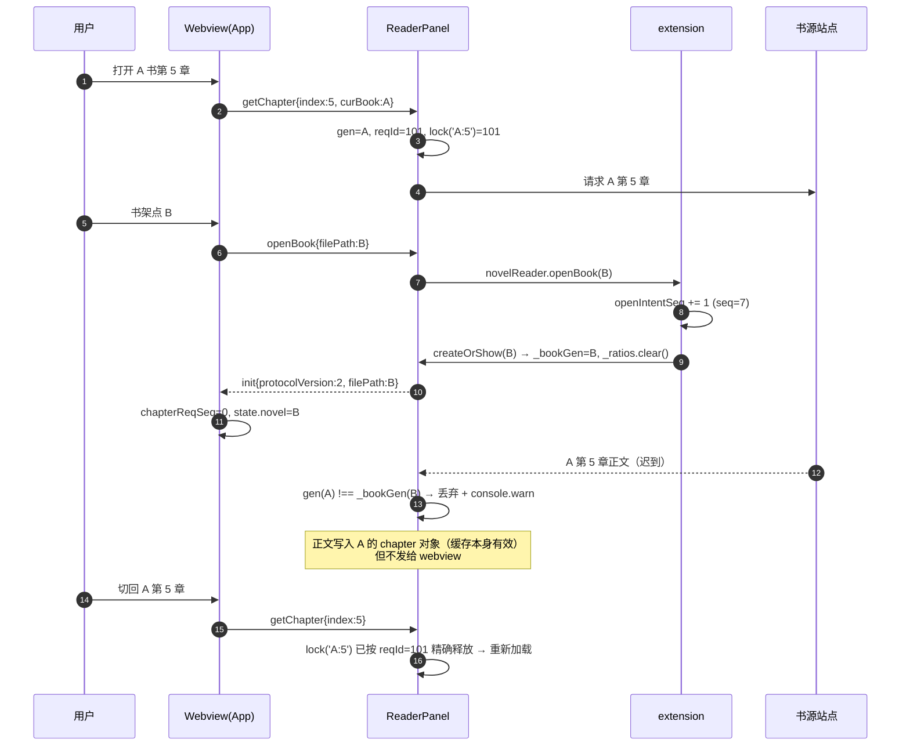
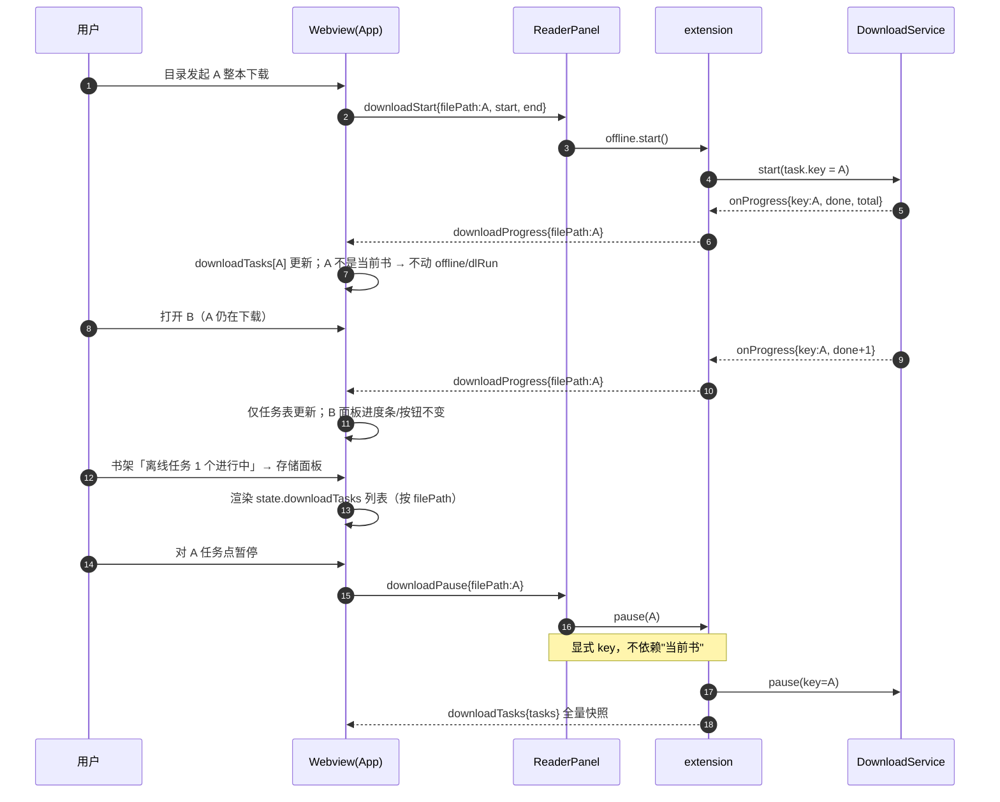
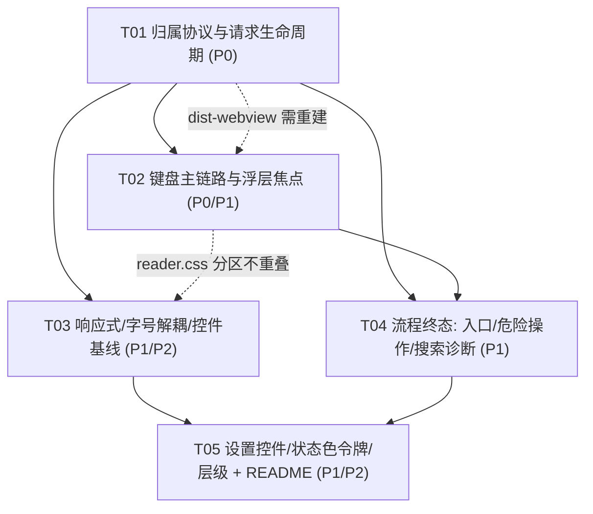
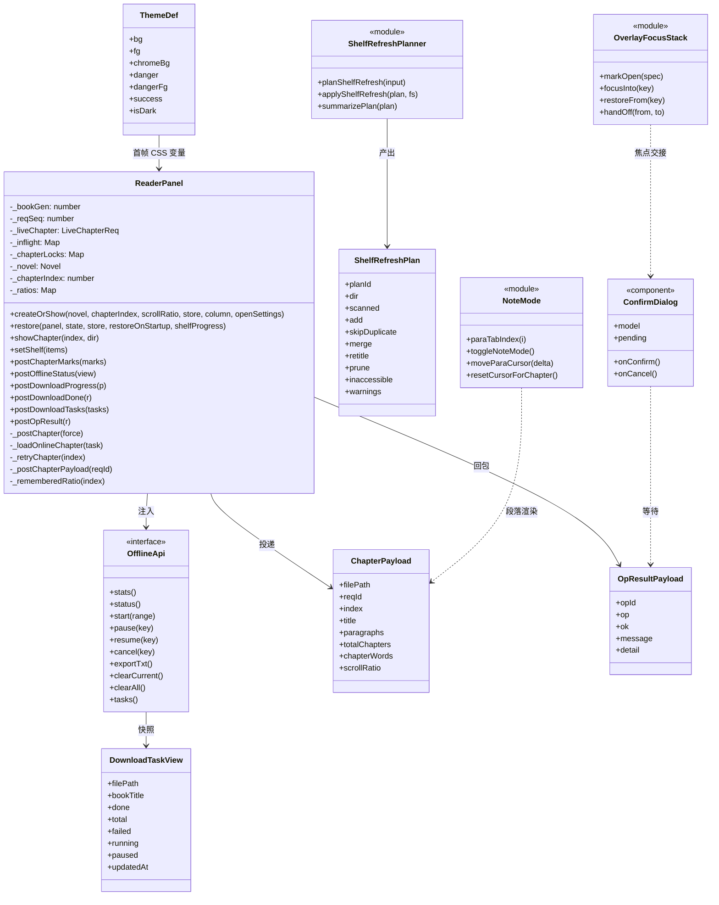
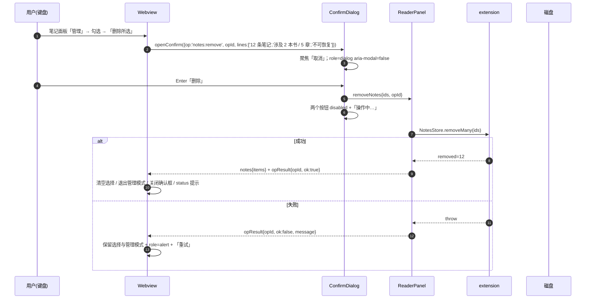
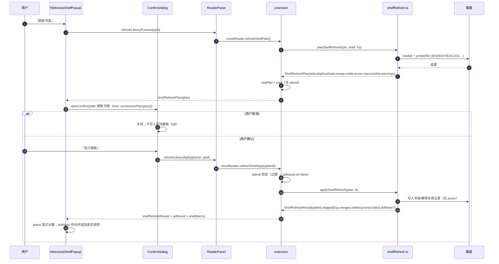
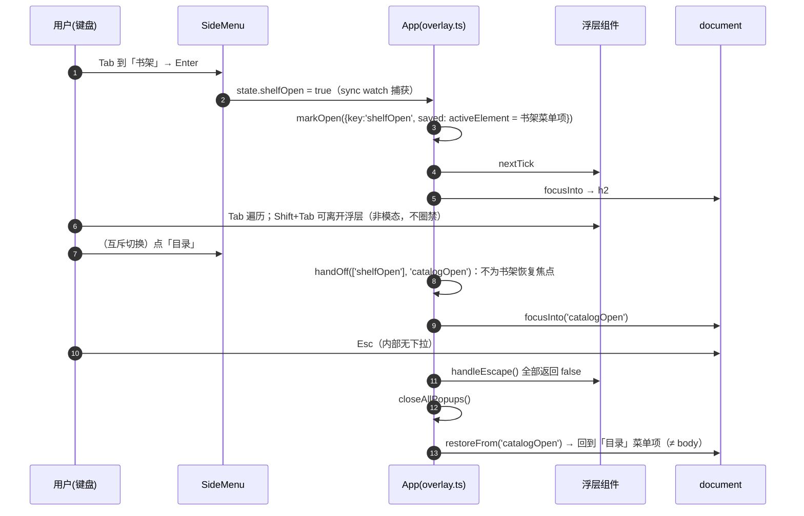

# r-novel-reader UI/UX 增量架构设计与任务分解

- **文档性质**：增量架构设计（非从零设计），对齐 `docs/ui-ux-review-prd.md`（72 条需求 / R1–R12）与 `docs/ui-ux-review.md`（12 项评审问题）
- **基线版本**：v1.48.7（`package.json`）
- **技术栈**：沿用现状 —— VS Code 扩展宿主 TypeScript（`tsc` → `dist/`）+ Webview Vue 3 + Vite 单文件 IIFE（`dist-webview/reader.js|reader.css`）+ 原生 CSS，无组件库、无构建体系变更
- **工作区约束**：`src/`、`webview/`、`scripts/`、`README.md`、`dist-webview/` 均存在大量未提交改动。**实施阶段只做增量编辑**：不得 `git checkout/reset/stash`，不得整段重写文件，`dist-webview/` 只能由 `npm run build:webview` 重新生成（禁止手改）。
- **本文档不修改任何产品代码**，只描述改法与顺序。

---

## 1. 方案总览与关键设计决策

### 1.1 一句话方案

在**不动布局骨架、不动主题美术、不动解析/存储引擎**的前提下，补三样"基础设施"：

1. **归属协议**（`filePath` + 单调 `reqId`）——让所有异步回包能自证"属于哪本书、哪一轮请求"；
2. **焦点/键盘基元**（浮层焦点栈 + roving tabindex 笔记本模式 + 原生 `button` 行语义）——让键盘与读屏能走完主链路；
3. **终态回包**（`opId` + 统一确认框 + 预演/执行两阶段）——让写操作有明确"进行中 → 成功/失败"，失败保留上下文。

其余（响应式 CSS、字号解耦、状态色令牌、控件尺寸与名称）都是"改属性值 + 追加分区 CSS"即可，不引入结构重排。

### 1.2 关键设计决策与取舍

| # | 决策 | 替代方案 | 取舍理由 |
|---|---|---|---|
| D1 | 归属字段统一复用 **`filePath`**（在线书即 `online://<sourceId>/<hash>`，与下载任务的 `key` 是同一个值），不新增 `bookKey`/`taskKey` 字段 | 新增独立 `key` 字段 | `onlineKey()` 与书架 `filePath` 本来就是同一个字符串（`src/onlinePath.ts:33`、`src/extension.ts:147-161`），再加一个字段只会让两端多一层映射，且违反"不发明与现有协议冲突的字段" |
| D2 | 请求号 **`reqId` 只在宿主生成**（`ReaderPanel._reqSeq`），webview 不自行编号 | 两端各自编号 | 单一编号源才不会出现"两端编号撞车"；webview 只需做"不得回退"兜底 |
| D3 | 归属校验采用 **协议版本协商**：宿主 `init` 带 `protocolVersion: 2`，webview 据此决定"严格/宽松" | 直接强制严格 | `dist-webview/*` 是构建产物，存在"webview 没重建 / 宿主已更新"的真实中间态。严格模式必须由宿主声明，否则老宿主 + 新 webview 会把全部消息丢掉（阅读页白屏） |
| D4 | 危险操作确认框放 **webview 内**（新组件 `ConfirmDialog.vue`），宿主命令通过 `skipConfirm` 参数跳过 `showWarningMessage({modal:true})` | 维持宿主模态框 | 宿主模态框：① 抢焦点、脱离浮层上下文；② 无法展示"数量/书名/章数/占用空间"多字段结构；③ happy-dom 冒烟测试无法断言。webview 内可用现成 `.popup-*` 视觉语言，且"失败保留选择与草稿"天然成立 |
| D5 | 保留宿主 `showWarningMessage` **调用形态向后兼容**：命令参数接受 `string[]`（旧）或 `{ filePaths, skipConfirm, opId }`（新） | 新增独立命令 | 命令面板/其他内部调用仍传数组（`novelReader.removeFromShelf` 等），只在 webview 路径上走对象；不破坏既有调用 |
| D6 | 行条目一律改**原生 `<button type="button">`**，保留全部现有 class 与 DOM 层级 | `div` + `tabindex=0` + `role="button"` + 手写 Enter/Space | 原生 button 自带 Enter/Space、disabled、读屏角色，且 `:focus-visible` 规则已存在（`reader.css:781-790`）；代价是需要在 CSS 里补一行 `font/color/background/border` 重置 |
| D7 | 段落笔记按钮**默认不进 Tab 序列**，靠"笔记模式 + roving tabindex"进入（PRD Q2） | 每段 `tabindex="0"` | 一章 100+ 段会产生 100+ 个 Tab 停靠点，键盘用户无法使用；roving 让整组只占 1 个停靠点 |
| D8 | 笔记模式入口 = **侧栏菜单开关 + `Alt+N`** | 新增正文浮动工具条 | 浮动工具条会改变"左侧导航—居中纸面—底部状态栏"布局（PRD 明确保留）；侧栏已有 `状态栏` 开关先例（`SideMenu.vue:166-185`），复用同一形态。`Alt+N` 与现有 `alt+←/→`（翻章）、`ctrl+alt+*`（摸鱼）无冲突 |
| D9 | UI 字号**固定 14/12px**，并把面板内所有由 `--font-size` 推导的字号改为由 `--ui-font` 推导（PRD Q6、R4-01） | 新增独立 UI 缩放设置 | 本轮不做新设置项；但只改 `--ui-font` 定义而保留 `calc(var(--font-size) * 1.2)` 等写法，R4-01 的"computed style 差值 = 0"验收仍不成立，必须一并改 |
| D10 | 页面宽度档位**只改展示层**（窄/标准/宽/特宽），`widthRatio` 数值与存储不变（PRD Q5、R8-04） | 改存储值并迁移 | 迁移引入数据风险，收益为零；档位名映射表放 `SettingsPanel.vue` 常量 |
| D11 | 新增 `dangerFg` / `success` 令牌，派生主题（省/节气/节日）用 `ensureContrast()` **逐主题算**，不写死颜色（PRD Q7/Q8、R10） | 全局固定 `#fff` + `#2ea043` | 现有 7 预设 + 58 派生主题底色差异大；`ensureContrast` 已是 `src/settings.ts` 现成能力（`src/settings.ts:707`），派生主题自动纳入 R10-04 |
| D12 | 刷新书架走 **预演(plan) → 确认 → 执行(apply)** 两阶段，`planId` 校验（PRD Q9/Q10、R7-05） | 直接执行后报告 | 现有实现直接写入并"顺带清理"（`extension.ts:1669-1775`），不可取消；两阶段才能满足"必须先给预演清单 + 可取消 + 数字一致" |
| D13 | 刷新书架的"清理失效"以 **`access()` 的错误码**为准：仅 `ENOENT` 记入 `prune`，`EACCES/EPERM/EBUSY/EMFILE/未知` 一律进 `inaccessible` 且**不清理** | `fs.existsSync()` 判定 | `existsSync` 对"权限不足"也返回 `false`，正是 R7-05 要禁止的"暂时不可访问 ≠ 已删除" |
| D14 | 后台下载进度进 **webview 任务表**（`state.downloadTasks`，按 `filePath` 键），只有 `filePath === 当前书` 才写当前面板的 `offline/dlRun` | 沿用"直接覆盖当前面板" | 现状 `downloadProgress` 无 key（`App.vue:452-484`），B 书会显示 A 的进度；任务表同时满足 R9-06「切走面板仍可查」 |
| D15 | 单源重试走**独立消息** `sourceRetry` / `sourceRetryResult` | 复用 `sourceSearch` + `sourceIds` | 现有 `searchResults` 处理会整体替换 `state.searchResults`（`App.vue:415-429`），复用会丢掉其它源的结果 |

### 1.3 分层与改动边界

```
┌──────────────────────────── webview (Vue 3, dist-webview 生成) ────────────────────────────┐
│ App.vue        浮层编排 + Esc 分层 + 消息路由（新增：归属/任务表/opResult 分支）              │
│ composables/overlay.ts   ★新增 焦点栈 + Esc 注册表 + 初始聚焦                              │
│ composables/noteMode.ts  ★新增 笔记模式 + roving tabindex                                 │
│ components/*            行语义 button 化、aria、确认框、任务表渲染                          │
└───────────────────────────────────────▲────────────────────────────────────────────────────┘
                     postMessage（src/protocol.ts 单一类型源，双向）
┌───────────────────────────────────────▼────────────────────────────────────────────────────┐
│ 宿主 (tsc → dist/)                                                                         │
│ ReaderPanel          归属校验/reqId/加载锁/opId 回包（不重写业务逻辑）                       │
│ extension.ts         打开意图序号 openIntentSeq、命令 skipConfirm、刷新 plan/apply           │
│ src/shelfRefresh.ts  ★新增 预演纯函数（可 node 单测，不 import vscode）                      │
│ settings.ts          新增 dangerFg/success 令牌                                            │
└────────────────────────────────────────────────────────────────────────────────────────────┘
```

---

## 2. 完整受影响文件表

### 2.1 新增文件

| 路径 | 作用 | 风险 |
|---|---|---|
| `src/protocol.ts` | 宿主 ↔ webview 消息载荷类型与 `PROTOCOL_VERSION` 单一来源（纯类型 + 常量，无 vscode 依赖） | 低。webview 通过相对路径 `../../src/protocol` 引入（`App.vue:10` 已有同型先例 `../../src/noteAnchor`），类型在构建期擦除 |
| `src/shelfRefresh.ts` | 刷新书架预演/执行计划的纯函数：`planShelfRefresh()`、`summarizePlan()`、`ShelfRefreshPlan/Result` 类型。不 import `vscode`，便于单测 | 低。新增模块，不触碰现有 `shelfMaintenance.ts` 的 `planDuplicateRemoval`（继续复用） |
| `webview/reader/composables/overlay.ts` | 浮层焦点栈：保存触发元素、打开后初始聚焦、关闭后恢复、Esc 分层注册表 | 中。是全 webview 的焦点中枢，写错会"焦点到处乱跳"。必须只由 App 调用，组件不直接调 |
| `webview/reader/composables/noteMode.ts` | 笔记模式状态 + roving tabindex 计算 + 方向键移动 + 关闭时焦点归位 | 中。与 `ReaderArea` 渲染紧密耦合 |
| `webview/reader/components/ConfirmDialog.vue` | 统一危险操作确认框（数量/对象/空间/可恢复性和主次按钮） | 中。被 4 处复用，props 契约要一次定对 |
| `scripts/test-ownership.js` | A/B 切书归属回归：驱动 `dist/readerPanel.js`，断言迟到回包被丢弃、加载锁按请求实例释放、下载控制按 key 生效 | 低（新增测试） |
| `scripts/test-shelf-refresh.js` | `dist/shelfRefresh.js` 的预演/执行一致性、`ENOENT` vs 不可访问降级 | 低 |
| `scripts/test-source-view.js` | `sourceView.ts` 容量分配与"空结果/失败"文案分流的纯函数测试 | 低 |

### 2.2 修改文件

| 路径 | 作用/改动性质 | 风险 |
|---|---|---|
| `src/readerPanel.ts` | 修改。归属字段、`_bookGen`/`_reqSeq`/请求实例锁、`opResult`、下载控制按 `filePath`、首帧 `--danger-fg/--success` 静态变量 | **高**。核心消息链路；必须保留所有现有消息字段与 `_ratios`/`_postChapter` 语义 |
| `src/extension.ts` | 修改。`openIntentSeq` 统一"打开意图"、`showSourcesPanel` 空书架直达、`resumeCurrent` 回第 1 章、下载进度带 `filePath`、刷新书架 plan/apply 命令、命令 `skipConfirm` 参数 | **高**。2070 行单体文件，改动点多；每处只做局部替换 |
| `src/settings.ts` | 修改。`ThemeDef` 增 `dangerFg`/`success`；7 套预设赋值；`paintTheme`/`paintFestivalNight` 计算两令牌 | 中。令牌被 4 个测试脚本断言，改错直接 `npm test` 红 |
| `webview/reader/App.vue` | 修改。消息路由（归属校验、任务表、`opResult`）、Esc 分层（删 `blurActiveElement`）、浮层焦点编排、`init` 协议版本 | **高**。816 行，是全 webview 的路由中枢 |
| `webview/reader/store.ts` | 修改。`applyThemeVars` 写入 `--danger-fg`/`--success`；新增 `state` 字段的辅助函数（如 `currentBookKey()`） | 中。`applyThemeVars` 影响首帧配色 |
| `webview/reader/composables/vscode.ts` | 修改。`state` 新增 `noteMode`/`downloadTasks`/`pendingOps`/`searchErrorOpen` 等；`ChapterPayload` 增 `filePath`/`reqId`；`gotoChapter` 携带 `curBook` | 中。所有组件都 import 这个文件 |
| `webview/reader/components/CatalogPanel.vue` | 修改。分卷/章节 button 化 + `aria-expanded/aria-controls/aria-current`；窄屏「更多」折叠容器；下载控件 `filePath`；进度区 `role=status`/`progressbar`；下载终态就地可见 | 中高。目录是高频面板 |
| `webview/reader/components/ShelfPopup.vue` | 修改。行 → 容器 + `button.bk-main` + 独立删除按钮（`aria-label="从书架移除《书名》"`、`aria-current`）；批量复选框原生；危险操作走确认框 + `opId` 终态 | 中 |
| `webview/reader/components/HistoryPopup.vue` | 修改。同上（行主按钮 + 批量复选框 + 确认框 + 终态） | 中 |
| `webview/reader/components/NotesPopup.vue` | 修改。书/章组头拆为并列控件（展开 button + 原生 checkbox + 删除 button）；`indeterminate` 半选；条目「更多」常显按钮；textarea `aria-label`；确认框 + 终态 | **高**。现有 DOM 是 button 内嵌可聚焦 span（`:352-392`），拆分会改变 Tab 序与样式，需回归 |
| `webview/reader/components/NoteComposer.vue` | 修改。`aria-label="笔记内容"`、错误 `role="alert"`、保存中禁用、失败保留草稿（现有逻辑已对，只补语义） | 低 |
| `webview/reader/components/ReaderArea.vue` | 修改。段落笔记按钮 + roving tabindex + `data-note-mode`；已有笔记可见标记；空态文案区分 | 中 |
| `webview/reader/components/SettingsPanel.vue` | 修改。主题预设 → `role="radio"` 组（保留 `.sp-dot[data-theme]` 便于既有测试）、可见名称、方向键；三个下拉 + `settingsOpen` 统一 `restoreTheme()`；宽度档位名；自定义输入 `label`；`handleEscape()` 暴露 | **高**。预览/主题/下拉三者耦合，是 R8 全部风险的集中点 |
| `webview/reader/components/SourceSearchView.vue` | 修改。结果行 → 容器 + 主按钮 + 操作组；失败明细展开（类型/原因/单源重试）；空结果 vs 失败文案分流；`status`/`alert`/`progressbar` 语义；容量实测 | **高**。400 行，含拖拽分栏与搜索状态机 |
| `webview/reader/components/SourceManageView.vue` | 修改。主操作唯一化（导入 + 子菜单）、次操作/更多、管理模式批量条、危险区隔离；复选框 `<label>` + 24×24 + `aria-label` 含源名；图标按钮 `aria-label`；输入 label | 中高 |
| `webview/reader/components/SourcePopup.vue` | 修改。标题 `<h2 id>` + `role="dialog" aria-modal="false" aria-labelledby`；`handleEscape` 透传（自身 `sourceView` 从 manage/dead 回 search 也算一层） | 低 |
| `webview/reader/components/StoragePopup.vue` | 修改。dialog 语义；清除本书/导出按钮禁用 + 原因；确认框（书名/章数/占用）；任务表渲染 | 中 |
| `webview/reader/components/SideMenu.vue` | 修改。`overflow-y:auto`、品牌区 sticky；新增「笔记模式」开关菜单项（`aria-pressed`） | 中。侧栏是布局骨架的一环，`min-height:100vh` 与 sticky 交互需实测 |
| `webview/reader/reader.css` | 修改。1542 行。分区改：① UI 字号解耦 ② 浮层宽度模型 ③ 侧栏/结果区滚动 ④ 焦点与行按钮重置 ⑤ `danger-fg`/`success` 接入 ⑥ 24×24 与粗指针 ⑦ 笔记动作组非 hover 可达 | **最高**。回归面最广 |
| `README.md` | 修改。仅两处：档位名（`:283`）、首次书源入口行为（`:249` 附近） | 低，但**已有未提交改动**，只允许改这两处 |
| `scripts/smoke-reader-vue.js` | 修改。9 处既有断言与本次改动冲突，必须同步（清单见 §8.2） | 中。3037 行，是唯一的 DOM 级回归网 |
| `scripts/test-theme-presets.js`、`test-province-theme.js`、`test-term-theme.js`、`test-festival-theme.js` | 修改。`REQUIRED` 增两令牌 + 两条对比度断言 | 低，但会立刻暴露未达标主题 |
| `scripts/test-panel-msg.js` | 修改。**当前未纳入 `npm test`，且断言"上一章落在底部 scrollRatio=1"与现实现（统一恢复该章记忆位置，无记忆回 0）不一致**。修复后纳入 `npm test` | 中 |
| `package.json` | 修改。`scripts.test` 追加新测试脚本；**不改依赖** | 低 |
| `dist-webview/reader.js`、`dist-webview/reader.css` | **生成物**。仅由 `npm run build:webview` 重生成后提交，禁止手改 | 低（不要编辑） |

---

## 3. 共享数据与协议变化

### 3.1 归属标识的生成与传递

| 标识 | 生成点 | 传递路径 | 消费/校验点 |
|---|---|---|---|
| `filePath` | 宿主唯一真相源：`_novel.filePath`（在线书 = `onlineKey(sourceId, bookUrl)` = `online://<sid>/<hash>`） | 所有宿主→webview 异步回包 | webview：`msg.filePath !== currentBookKey()` → `console.warn` + 丢弃 |
| `reqId`（章节/预览） | 宿主 `ReaderPanel._reqSeq`（单调 +1） | `chapterLoading` / `chapter` / `chapterError` / `chapterCached` / `previewReady` / `previewError` | 宿主：`reqId === _liveChapter.reqId` 才发；webview：`reqId < state.chapterReqSeq` → 丢弃（兜底） |
| `bookGen`（书代号） | 宿主 `ReaderPanel._bookGen`（换书 +1） | 不直接下发；用于宿主内部判定"是否同一本书" | 宿主：`gen === this._bookGen` 且 `ReaderPanel.current === this` |
| `openIntentSeq`（打开意图） | 宿主 `extension.ts` 模块级计数 | 不进消息；`previewOnlineBook` / `loadOnlineNovel` / `loadNovel` 各自捕获 | 宿主：`seq === openIntentSeq` 才 `createOrShow`（取代现有只覆盖预览的 `previewSeq`） |
| `opId`（写操作） | webview 生成（`state.opSeq += 1`） | webview→宿主请求带 `opId`；宿主 `opResult` 原样回传 | webview：`opId` 匹配才清 pending / 收尾 UI |
| `planId`（刷新书架预演） | 宿主 `shelfPlanSeq` | `shelfRefreshPlan.planId` → `refreshLibraryApply{planId}` | 宿主：`planId === lastPlan.planId` 才执行，否则回"预演已过期，请重试" |

**为什么 `filePath` 不够、必须再要 `reqId`**：同一本书内"重试同章"会产生两轮请求，两次回包的 `filePath` 完全相同；只有 `reqId` 能区分"这一份正文属于哪一轮"。**为什么 `reqId` 不够、必须再要 `filePath`**：`_reqSeq` 是同一个面板的全局计数，切书后 A 的 `reqId=N` 与 B 的 `reqId=N+1` 都"更大"，仅靠单调性无法判断归属。

### 3.2 消息兼容策略（三层）

1. **新增字段一律可选**：`filePath?`、`reqId?`、`opId?`、`protocolVersion?`。老 webview 收到多余字段直接忽略（结构化克隆允许多余属性）。
2. **严格模式由宿主声明**：`init.payload.protocolVersion === 2` 时 webview 才 `ownershipStrict = true`。宽松模式下缺 `filePath` 的消息照旧应用（仅 `console.warn`），保证"宿主已更新 / dist-webview 未重建"不会白屏。
3. **命令参数双形态**：`novelReader.removeBooksFromShelf` 等接受 `string[]`（旧）或对象（新）。沿用现有 `sourceCheck` 的"兼容旧调用"写法（`readerPanel.ts:1118-1122`）。

### 3.3 TypeScript 草案

```ts
// ─────────────────────────── src/protocol.ts（新增） ───────────────────────────
export const PROTOCOL_VERSION = 2;

/** 所有异步回包的可选归属字段（在线书的 filePath 即下载任务 key） */
export interface Owned {
  filePath?: string;
  /** 宿主单调递增请求号；缺省 = 老宿主（宽松模式） */
  reqId?: number;
}

/** 章节载荷：新增 filePath + reqId（其余字段与现状一致，不得改名） */
export interface ChapterPayload extends Owned {
  index: number;
  title: string;
  paragraphs: string[];
  totalChapters: number;
  chapterWords: number;
  scrollRatio: number;
}

export interface ChapterLoadingPayload extends Owned { index: number; title?: string }
export interface ChapterErrorPayload extends Owned { index: number; message: string }
export interface ChapterCachedPayload extends Owned { index: number }

/** 预览：保留 bookUrl 过滤（既有语义），补 reqId 供"超时后迟到成功"判定 */
export interface PreviewReadyPayload extends Owned { bookUrl: string }
export interface PreviewErrorPayload extends Owned { message: string; bookUrl?: string }

/** 下载任务（任务表 + 进度 + 结束） */
export interface DownloadTaskView {
  filePath: string;          // = 在线书 online:// 键
  bookTitle: string;
  done: number;
  total: number;
  failed: number;
  running: boolean;
  paused: boolean;
  updatedAt: number;
}
export interface DownloadProgressPayload extends Owned {
  done: number; total: number; failed: number;
  running: boolean; paused: boolean;
  index?: number; title?: string; added?: number[];
  bookTitle?: string;
}
export interface DownloadDonePayload extends Owned {
  ok: boolean; cancelled: boolean; done: number; total: number;
  failed: number; message?: string;
}
/** 宿主→webview 任务表全量快照（init / 控制回包 / 结束时下发） */
export interface DownloadTasksPayload { tasks: DownloadTaskView[] }

/** 写操作统一终态 */
export type OpKind =
  | 'notes:remove' | 'notes:removeGroup'
  | 'books:remove' | 'books:removeMany'
  | 'history:remove' | 'history:clear'
  | 'offline:clearCurrent' | 'offline:clearAll' | 'offline:export'
  | 'shelf:refresh';
export interface OpResultPayload {
  opId: string;
  op: OpKind;
  ok: boolean;
  message?: string;
  /** 部分成功时的细节（如刷新书架各项计数） */
  detail?: Record<string, number>;
}

/** 搜索失败明细 + 单源重试 */
export interface SourceErrorDetail {
  sourceId: string;
  sourceName: string;
  /** 归一化后的类别，供 UI 直出中文标签 */
  category: 'timeout' | 'network' | 'http' | 'parse' | 'rule' | 'unsupported' | 'abort' | 'fatal';
  message: string;
}
export interface SourceRetryResultPayload {
  reqId: number;
  sourceId: string;
  sourceName: string;
  ok: boolean;
  message?: string;
  items?: SearchBookItemView[];   // 成功时该源的命中，追加进当前结果
}

/** 刷新书架预演/执行（宿主侧 src/shelfRefresh.ts 定义实现，类型放这里供两端共用） */
export interface ShelfRefreshPlan {
  planId: number;
  dir: string;
  scanned: number;
  add: { filePath: string; title: string; author: string; totalChapters: number }[];
  skipDuplicate: string[];
  merge: { keep: string; removals: string[] }[];
  retitle: { filePath: string; from: string; to: string }[];
  /** 仅"目录可枚举且 access() 报 ENOENT"的条目 */
  prune: { filePath: string; title: string }[];
  /** 暂时不可访问（EACCES/EPERM/EBUSY/EMFILE/未知）：一律不清理 */
  inaccessible: { filePath: string; reason: string }[];
  warnings: string[];
}
export interface ShelfRefreshResult {
  planId: number;
  added: number; skippedDup: number; merged: number; retitled: number; pruned: number;
  failed: { filePath: string; error: string }[];
  /** 与预演不一致时给出的差异说明 */
  driftNote?: string;
}
```

webview 侧 `state` 新增字段（`composables/vscode.ts`）：

```ts
// 归属与终态
ownershipStrict: false,          // init 里 protocolVersion>=2 时置 true
chapterReqSeq: 0,                // 已接受的最大 reqId（init 时归零）
downloadTasks: {} as Record<string, DownloadTaskView>,
pendingOps: {} as Record<string, { op: OpKind; at: number }>,
opSeq: 0,
// 键盘与笔记模式
noteMode: false,
noteParaCursor: 0,
// 搜索终态
searchErrorOpen: false,
sourceRetries: {} as Record<string, { running: boolean; ok?: boolean; message?: string }>,
searchAnnounce: '',              // sr-only live region 的节流文案
// 确认框（同一时刻只一个）
confirm: null as null | {
  title: string; lines: string[]; danger: boolean;
  confirmText: string; cancelText?: string;
  op: OpKind; opId: string;
  payload: Record<string, unknown>;   // 执行时原样回传给宿主
},
```

> 约定：`confirm` 与 `sourceOpen` 等浮层**不共用互斥数组**（它是"浮层内的确认层"，可以覆盖在书架/笔记/历史/存储面板之上），但同一时刻只允许一个。

### 3.4 时序图：A/B 切书迟到回包





---

## 4. 三处高风险改造的细化设计

### 4.a 在线章节串书与下载归属

#### 4.a.1 宿主侧字段与不变量

```ts
class ReaderPanel {
  private _bookGen = 0;                 // 换书/恢复时 +1
  private _reqSeq = 0;                  // 面板级单调请求号
  private _liveChapter: { reqId: number; gen: number; index: number } | null = null;
  private _inflight = new Map<number, { gen: number; index: number }>();   // reqId -> 任务
  private _chapterLocks = new Map<string, number>();                       // `${gen}:${index}` -> reqId
}
```

不变量（写成注释钉在代码里，也是 code review 检查项）：

1. **I1 捕获即冻结**：任何异步函数体内只允许使用入口处捕获的 `const novel = this._novel` / `const gen = this._bookGen` / `const index`。**禁止** `await` 之后再读 `this._novel`、`this._chapterIndex`（R2-01 的验收就是查这个）。
2. **I2 唯一活请求**：`_liveChapter` 只保留最新一轮；回包时 `reqId !== _liveChapter.reqId` → 丢弃 + `console.warn('[reader] 丢弃过期章节回包', {reqId, live})`。
3. **I3 锁按请求实例释放**：`finally` 里 `if (this._chapterLocks.get(key) === reqId) this._chapterLocks.delete(key)`。这样"重试产生的第二轮"不会因第一轮结束而丢锁（R2-05）。
4. **I4 缓存写入与投递分离**：正文写入"捕获到的 novel 对象"，**投递**才判断 `gen === this._bookGen && ReaderPanel.current === this`。迟到的 A 正文仍然进 A 的临时缓存（对 A 后续打开是有益的），但绝不投给 B。
5. **I5 归属必填**：所有 `_post*` 方法内部统一 `filePath: this._novel.filePath`（或捕获值），不允许遗漏（`_postChapterPayload`、`_postChapterMarks`、`postDownloadProgress`、`postDownloadDone`、`postOfflineStatus`）。

#### 4.a.2 关键改法清单

| 位置 | 现状 | 改为 |
|---|---|---|
| `readerPanel.ts:1377-1407` `_loadOnlineChapter` | `await loader(this._novel, index)`，回包后 `this._novel.chapters[index]`、`this._chapterIndex === index` 判定，`this._loadingChapters.delete(index)` | 签名改 `_loadOnlineChapter(task: { novel; gen; index; reqId })`；`chapter = task.novel.chapters[task.index]`；投递条件 `task.gen === this._bookGen && task.reqId === this._liveChapter?.reqId`；`finally` 按 I3 释放 |
| `readerPanel.ts:1356-1374` `_postChapter` | `if (this._loadingChapters.has(index)) return;` | `const key = gen + ':' + index; if (this._chapterLocks.has(key)) return;`（非 force）；`reqId = ++_reqSeq` 写锁与 `_liveChapter` |
| `readerPanel.ts:1410-1417` `_retryChapter` | 删锁后重走 `_postChapter()` | `_postChapter({ force: true })`：允许同章开新一轮，旧轮靠 I2 丢弃 |
| `readerPanel.ts:383-384` `createOrShow` | `cur._ratios.clear(); cur._loadingChapters.clear();` | 追加 `cur._bookGen += 1; cur._liveChapter = null; cur._inflight.clear(); cur._chapterLocks.clear();`（`_inflight` 清空后迟到回包靠 gen 不匹配丢弃） |
| `readerPanel.ts` 构造函数 / `restore` | 无 gen 概念 | 初始化 `_bookGen = 1`（每个面板实例独立，`ReaderPanel.current` 单例天然互斥） |
| `extension.ts:801,875,880` `previewSeq` | 只在新的预览时 +1 | 替换为 `openIntentSeq`：在 `loadNovel` / `loadOnlineNovel` / `previewOnlineBook` / `openReaderFromLauncher` / `resumeCurrent` / `restore` **入口处**（任何 `await` 之前）执行 `const seq = ++openIntentSeq`，并在 `createOrShow` 之前校验 `if (seq !== openIntentSeq) return {...}`。这样"预览 A 慢 → 用户从书架开 B → A 才回来"不会把面板切回 A（R2-07） |
| `extension.ts:457-520` `queueProgress`/`flushProgress`/`finishDownload` | 进度无 key，投给 `ReaderPanel.current` 就算"当前书" | payload 增 `filePath: p.key`、`bookTitle`；`flushProgress` 只投给"存在面板"的 `ReaderPanel.current`（webview 按 key 路由，见 §4.a.3）；`finishDownload` 额外 `postDownloadTasks()` 全量快照；`pushOfflineStatus` 保持"当前书视角"但**只在 key 匹配时**才改 `offline`（由 webview 端判定） |
| `readerPanel.ts:868-889` `downloadStart/Pause/Resume/Cancel` | `ReaderPanel.offline?.pause()` 无参数 | 消息带 `filePath`；`OfflineApi.pause(key)/resume(key)/cancel(key)` 改为**接受 key**（`OfflineApi` 定义在 `readerPanel.ts:195-207`）；宿主实现 `key => downloadService.pause(key)`；`msg.filePath` 缺省才回退 `currentOfflineKey()` |
| `extension.ts` `startOfflineDownload` | `ReaderPanel.current?.postDownloadProgress(...)` 立即回一帧 | 该帧带 `filePath: key`；并 `postDownloadTasks()` |
| `readerPanel.ts` 任务表快照 | 无此消息 | 新增 `postDownloadTasks()`：把 `ReaderPanel.offline?.tasks()` 的结果包成 `{type:'downloadTasks', payload:{tasks}}` 推给 webview。触发点：`init` 之后、`downloadStart/Pause/Resume/Cancel` 回包后、`finishDownload`、`offlineStatus` 请求、`clearCurrent/clearAll` 之后。`OfflineApi` 增 `tasks(): DownloadTaskView[]`（宿主用 `downloadService` 的 running 表 + `offlineIndex` 拼装，字段见 §3.3） |

#### 4.a.3 webview 侧路由

```ts
function currentBookKey(): string { return (state.novel && state.novel.filePath) || ''; }

/** 归属校验：严格模式缺字段即拒绝 */
function ownedBy(msg: { filePath?: string }, tag: string): boolean {
  const cur = currentBookKey();
  if (!msg.filePath) {
    if (state.ownershipStrict) { console.warn('[reader] 拒绝无归属回包', tag); return false; }
    return true;
  }
  if (msg.filePath !== cur) { console.warn('[reader] 丢弃异书回包', tag, msg.filePath, cur); return false; }
  return true;
}
```

- `chapter` / `chapterLoading` / `chapterError` / `chapterCached`：先 `ownedBy`，再 `if (p.reqId != null && p.reqId < state.chapterReqSeq) 丢弃`，接受后 `state.chapterReqSeq = p.reqId`。
- `init`：`state.chapterReqSeq = 0; state.ownershipStrict = p.protocolVersion >= PROTOCOL_VERSION`；`state.downloadTasks` 不因换书清空（任务表是全局视图）。
- `downloadProgress`：**总是**写 `state.downloadTasks[filePath]`；仅当 `filePath === currentBookKey()` 时再走现有 `dlRun` / `offline` 合并逻辑（保留 `App.vue:452-484` 的 `added` 增量与 `downloaded` 兜底策略）。
- `downloadDone`：总是更新任务表（`running:false`）；仅当前书更新 `state.dlNotice`；`dlNotice` 同时给出"其他面板可查"的入口（见 §5.5）。

#### 4.a.4 A/B 切书测试怎么构造（`scripts/test-ownership.js`）

复用 `scripts/test-panel-msg.js` 的 vscode 桩（`createWebviewPanel` 假 panel、`onDidReceiveMessage` 存监听、`postMessage` 收集）。测试骨架：

```js
// 1) 可控的章节 loader：返回"挂起"的 promise，由测试决定何时 resolve
const pending = [];
ReaderPanel.onlineChapterLoader = (novel, index) => new Promise((res) => pending.push({ novel, index, res }));
ReaderPanel.bookSources = { /* addOnlineBook 等最小桩 */ };

// 2) 打开 A（在线书：章节 content 为空 → 触发懒加载）
ReaderPanel.createOrShow(novelA, 4, 0, store);
fire({ type: 'ready' });
assert(posted.some(m => m.type === 'chapterLoading' && m.payload.filePath === 'online://s/aaa' && typeof m.payload.reqId === 'number'));

// 3) 切到 B（同面板 createOrShow 不同 filePath → _bookGen +1）
ReaderPanel.createOrShow(novelB, 0, 0, store);
posted.length = 0;

// 4) A 的回包迟到
pending[0].res(['A 的正文']);
await tick();
assert(!posted.some(m => m.type === 'chapter' && m.payload.filePath.endsWith('aaa')), 'A 的迟到正文不得投递给 B');
assert(!posted.some(m => m.type === 'chapterCached' && m.payload.filePath.endsWith('aaa')), 'A 的缓存点位不得投给 B');
assert(pending[0].novel.chapters[4].content === 'A 的正文', 'A 的缓存写入仍应生效（I4）');

// 5) 锁按请求实例释放：切回 A，同章应能重新加载
ReaderPanel.createOrShow(novelA, 4, 0, store);
assert(posted.some(m => m.type === 'chapterLoading'), '同章锁必须已释放，可再次加载');

// 6) 重试同章两轮：第一轮结束不得释放第二轮的锁
//    第一轮未回包时发 retryChapter → 产生 reqId2；让 reqId1 先 resolve
//    断言：reqId1 的回包被丢弃（reqId !== _liveChapter.reqId），且第二轮仍持锁（不会重复起第三轮）

// 7) 下载归属：模拟 queueProgress 两个 key，断言 downloadProgress 带 filePath；
//    downloadPause{filePath: A} 在 B 为当前书时仍作用于 A（断言 downloadService 桩收到的 key）
```

同时补一条**静态守卫测试**（防止回归成 `this._novel` 写法）：读取 `dist/readerPanel.js` 文本，断言 `_loadOnlineChapter` 函数体内 `await` 之后不出现 `this._novel`（用 `indexOf` 定位函数边界做粗粒度断言即可，允许失败时人工复核，作为提醒而非铁律）。

---

### 4.b 键盘语义与笔记模式

#### 4.b.1 行条目：禁止按钮嵌套

统一三种模式（对应用 PRD R1-01/R1-03/R1-07）：

```
单一主动作（目录章节、历史行、搜索结果行）:
  <button type="button" class="cat-item" aria-current="true|undefined">…</button>

多动作（书架行、笔记条目）:
  <div class="bk [cur]" data-bk-path>            ← 容器：无 click、无 role
    <button type="button" class="bk-main">…书名/进度…</button>   ← 主动作
    <button type="button" class="bp-del" aria-label="从书架移除《书名》">✕</button>
  </div>

组头三件套（笔记书/章组、书源批量）:
  <div class="nt-book-head">                     ← 容器：无 role
    <button type="button" class="nt-expand" aria-expanded aria-controls="nt-items-…">▶ 书名</button>
    <input type="checkbox" class="bk-check" :indeterminate.prop="some" aria-label="选择《书名》的全部笔记">
    <button type="button" class="ng-del" aria-label="删除《书名》的全部笔记">删除</button>
  </div>
```

现有 `NotesPopup.vue:336-393` 是 `<button class="nt-book-head">` 内嵌 `role="button" tabindex="0"` 的 `.ng-del`——**这会被浏览器解析成"按钮内嵌可聚焦 span"**，读屏与 Enter 行为都不确定。必须按上面第三式拆分：外层改 `div`（保留 `.nt-book-head` 类与布局），展开动作移到内部 `button.nt-expand`。

CSS 配套（追加分区，不改既有布局值）：

```css
/* ===== 行按钮语义重置（T02） ===== */
.cat-item, .bk-main, .hist-row-main, .src-result-main, .nt-expand {
  font: inherit; color: inherit; background: none; border: 0; padding: 0;
  text-align: left; width: 100%; cursor: pointer;
}
.cat-item:focus-visible, .bk-main:focus-visible, .hist-row-main:focus-visible,
.src-result-main:focus-visible, .nt-expand:focus-visible {
  outline: 2px solid var(--sp-accent); outline-offset: -2px;
}
```

> 已有 `button:focus-visible { outline: 2px solid var(--sp-accent) }`（`reader.css:787-790`）会命中，但行是通栏元素、`outline-offset:-2px` 更贴合现有 `border-left` 视觉，故显式覆盖。

**冒烟测试的连带改动**（必须同批）：`.bk` / `.hist-row` / `[data-src-result]` 的 `click()` 要改点到主按钮；`data-*` 属性保留在容器上（测试选择器仍可用）。

#### 4.b.2 浮层焦点栈（`composables/overlay.ts`）

```ts
export type PopupKey =
  | 'catalogOpen' | 'settingsOpen' | 'shelfOpen' | 'storageOpen'
  | 'notesOpen' | 'sourceOpen' | 'historyOpen';

export interface OverlaySpec {
  key: PopupKey;
  titleId: string;                    // <h2 id>
  /** 无触发元素时的确定性 fallback 选择器（对应侧栏菜单项） */
  fallbackSelector: string;           // '[data-menu="shelf"]'
}

/** 打开：保存触发元素（调用点仍在事件序内 → activeElement 就是被点的按钮） */
export function markOpen(spec: OverlaySpec): void;

/** 打开后一帧：标题 → 关闭按钮 → 首个可聚焦控件 */
export function focusInto(key: PopupKey): void;

/** 关闭：恢复触发元素；不存在/不可见则 fallback → #reader */
export function restoreFrom(key: PopupKey): void;

/** 互斥切换（书架 → 目录）：不为旧浮层恢复焦点，只为新浮层聚焦 */
export function handOff(from: PopupKey[], to: PopupKey): void;
```

实现要点（也是风险点）：

1. **统一入口在 App，不在组件**。现在"打开/关闭"分散在 `SideMenu.toggle()`、`App.openTab()`、`App.closeAllPopups()`、各组件内 `state.xxxOpen = false`、`init` 的 `openSettings`。因此 App 用一个 `{ flush: 'sync' }` 的 `watch` 监听 `popupKeys` 签名（现有 `App.vue:78-90` 的收敛 watch 保留）：
   - 某 key `0 → 1`：`markOpen(spec)`（同步读到 `document.activeElement`）；`nextTick` 后 `focusInto`。
   - 某 key `1 → 0` 且同一 tick 内没有别的 key `0 → 1`：`nextTick` 后 `restoreFrom`。
   - 有 key 关闭同时有 key 打开（互斥切换）：`handOff`，只聚焦新浮层。
2. **删除 `blurActiveElement()` 及其 5 个调用点**（`App.vue:687-692` 定义，`:700,706,712,721,727` 调用）。焦点框残留问题已由 `:focus-visible` 规则解决（`reader.css:781-790`），无需 blur。
3. **Esc 分层**（R5-05）。App 持有 `key → ComponentRef` 映射（现有 `catalogRef` 等已具备），每个浮层 `defineExpose({ el, handleEscape })`：
   ```ts
   function onKeyDown(e: KeyboardEvent): void {
     if (e.key !== 'Escape') { /* 快捷键分支… */ return; }
     if (state.confirm) { e.preventDefault(); cancelConfirm(); return; }          // 确认层最内
     if (state.noteComposer) { e.preventDefault(); state.noteComposer = null; return; }
     for (const key of openKeys()) {                    // 内部下拉 → 浮层 → 侧栏
       if (overlayRef(key)?.handleEscape?.()) { e.preventDefault(); return; }
     }
     if (anyPopupOpen()) { e.preventDefault(); closeAllPopups(); return; }        // 关闭后由 watch 恢复焦点
     if (state.menuExpanded) { e.preventDefault(); state.menuExpanded = false; return; }
   }
   ```
   `SettingsPanel.handleEscape()`：依次关 省份/节气/节日 下拉（每次关都 `restoreTheme()`），全关才返回 `false` 让位给"关面板"。
   `NotesPopup.handleEscape()`：先退编辑 → 再退两步删除确认 → 全无则 `false`。
   `SourceManageView.handleEscape()`：先退行内编辑 → 再 `false`；`SourcePopup` 在 `manage/dead` 视图时 Esc 先回 `search`（视为"内部一层"）。
4. **非模态不圈禁**（R5-02）：不监听 Tab、不设置 `inert`、不拦截焦点离开。语义用 `role="dialog" aria-modal="false" aria-labelledby="<h2 id>"`。
5. **标题改真 `<h2>`**：`<b class="popup-title">书架</b>` → `<h2 class="popup-title" id="shelfPopupTitle" tabindex="-1">书架</h2>`。`h2` 默认有 margin，CSS 需补 `.popup-title{margin:0;font-size:calc(var(--ui-font) + 1px);font-weight:700}`（现有规则 `reader.css:567` 只设 font-size，`b` 无 margin，`h2` 有 → 必须显式 `margin:0`）。

#### 4.b.3 笔记模式与 roving tabindex（`composables/noteMode.ts`）

状态：`state.noteMode`（开/关）、`state.noteParaCursor`（roving 停靠段落下标）、`state.noteModeReturn`（开启时焦点元素，关闭时回位；放在模块内变量，不必进 reactive）。

渲染（`ReaderArea.vue`）：

```html
<p v-for="(p, i) in paras" :key="i" class="rd-para" :data-p="i"
   :class="{ 'rd-para-noted': paraNotes.has(i), 'rd-para-active': composerPara === i }"
   @mousedown="onParaMouseDown" @click="onParaClick(i, $event)">
  {{ p }}<button type="button" class="rd-note-btn" :data-para-btn="i"
     :tabindex="paraTabIndex(i)" :aria-label="paraBtnLabel(i)"
     @click.stop="openComposerFor(i, $event)">{{ paraNotes.has(i) ? '查看笔记' : '添加笔记' }}</button>
</p>
```

```ts
export function paraTabIndex(i: number): number {
  return state.noteMode && i === state.noteParaCursor ? 0 : -1;   // 默认 -1：不进 Tab 序列
}
export function toggleNoteMode(): void {
  state.noteMode = !state.noteMode;
  state.noteParaCursor = firstNonEmptyPara();
  if (!state.noteMode) { focusMenuToggle(); }           // 关闭：焦点回开关（R1-06）
}
export function moveParaCursor(delta: 1 | -1): void {
  const next = nextNonEmpty(state.noteParaCursor, delta);   // 跳过空段落，到边界停住
  if (next === state.noteParaCursor) { return; }
  state.noteParaCursor = next;
  nextTick(() => (document.querySelector(`[data-para-btn="${next}"]`) as HTMLElement | null)?.focus());
}
```

键盘绑定放在段落按钮上：`ArrowDown/ArrowRight → moveParaCursor(1)`、`ArrowUp/ArrowLeft → -1`、`Home/End` 到首/末非空段落；`Enter/Space` 走原生 button 行为（触发 click → 打开/查看笔记卡片）。切章时 `watch(state.chapter)` → `state.noteParaCursor = firstNonEmptyPara()`。

可见性（CSS，追加分区）：

```css
.rd-note-btn { opacity: 0; transition: opacity .12s ease; margin-left: 6px;
  font-size: var(--ui-font-sub); color: var(--accent); background: none;
  border: 1px solid transparent; border-radius: 4px; padding: 0 6px; cursor: pointer; }
.rd-para:hover .rd-note-btn, .rd-note-btn:focus-visible { opacity: 1; border-color: var(--accent); }
/* 已有笔记：始终可见（不只依赖虚线下划线这一"颜色/形状"单通道 + R11-06 双通道） */
.rd-para-noted .rd-note-btn { opacity: 1; }
/* 笔记模式：全量可见可聚焦 */
#content[data-note-mode="on"] .rd-note-btn { opacity: 1; }
```

`ReaderArea` 根 `<article id="content" :data-note-mode="state.noteMode ? 'on' : 'off'">`。

> 注意：`.rd-para-noted` 现在对 `p` 加虚线下划线（`reader.css:1460`），按钮文字也会被下划线穿过 → 改为 `#content p.rd-para-noted .rd-text`（把正文包一层 `span.rd-text`）或 `text-decoration-skip-ink` + 按钮 `text-decoration: none`。**取最小改动**：`.rd-note-btn { text-decoration: none; }`。

#### 4.b.4 焦点栈与"非模态浮层不被破坏"的边界

- 焦点栈只在**浮层开关**时介入；`noteComposer`（笔记卡片）、`overlay` 预览浮窗、`note-preview` 悬浮窗**不进栈**（它们是"就地小层"，关闭不迁移焦点）。这避免"关掉悬浮预览把焦点抢走"。
- 若用户在浮层内点了别的浮层元素（互斥切换），`handOff` 保证只聚焦一次，不会出现"先回 A 的触发点、再进 B"的抖动。
- 外部协议（`openDrawer`）打开时 `document.activeElement` 通常是 `body` → `markOpen` 记 `null`，`restoreFrom` 走 `fallbackSelector`（侧栏菜单项）→ 再不行 `#reader`（R5-04）。

---

### 4.c 危险操作与刷新书架预演

#### 4.c.1 统一确认组件（`ConfirmDialog.vue`）

Props/契约：

```ts
interface ConfirmModel {
  title: string;                  // 「删除 12 条笔记」
  lines: string[];                // 结构化明细：对象名/章节范围/占用空间/是否可恢复
  danger: boolean;                // 主按钮危险态
  confirmText: string;            // 「删除」/「清空」/「执行刷新」
  cancelText?: string;            // 默认「取消」
  op: OpKind;
  payload: Record<string, unknown>;  // 交给宿主执行的参数（filePaths / ids / planId…）
  /** 失败时是否保留选择与草稿（危险批量操作 = true） */
  keepContextOnFail?: boolean;
}
```

行为：`role="dialog" aria-modal="false"`、`aria-labelledby`、打开聚焦**取消按钮**（危险操作默认不聚焦破坏性按钮）、Esc = 取消、关闭后焦点回"触发按钮"（复用 `overlay.ts` 的 `markOpen/restoreFrom`，用伪 key `'confirm'`）。执行中：两个按钮 `disabled` + 主按钮文案「操作中…」；`state.pendingOps[opId]` 存在期间禁止重复提交（R9-05）。

一致性规则（R7-01）：三类危险操作（批量删笔记、批量删历史、清本书离线）都走同一组件；`lines` 至少含"数量 + 对象名"，清离线额外含"章数 + 占用空间"，每类都标明"不可恢复 / 可从回收站恢复"。

#### 4.c.2 成功才退出管理模式（R7-03）

```
webview（NotesPopup/HistoryPopup/ShelfPopup）
  点「删除所选」→ openConfirm({op:'notes:remove', opId, payload:{ids}})
    → 确认 → send({type:'removeNotes', ids, opId})   // 现有消息加可选 opId
    → 收到 opResult{opId, ok:true}  → 关闭确认框 → managing=false; selected=[]
    → 收到 opResult{opId, ok:false} → 关闭确认框 → 保留 managing/selected →
                                     role="alert" 就地显示 message + 「重试」
```

宿主配套：`removeNotes` / `removeNoteGroup` / `removeBooks` / `removeHistory` / `clearHistory` / `offlineClearCurrent` / `offlineClearAll` 分支统一 `try/catch` 后 `postOpResult({opId, op, ok, message})`。缺少 `opId` 的旧调用不发送 `opResult`（保持旧行为）。

#### 4.c.3 三个宿主命令的 `skipConfirm` 扩展

```ts
// 兼容：string[]（旧）| { filePaths, skipConfirm?, keepOffline?, opId? }（新）
type RemoveBooksArg = string[] | { filePaths: string[]; skipConfirm?: boolean; keepOffline?: boolean; opId?: string };
```

`novelReader.removeBooksFromShelf`、`novelReader.removeFromShelf`、`novelReader.removeHistory`、`novelReader.clearHistory` 四个命令在入口做 `normalize(arg)`；`skipConfirm === true` 时跳过 `showWarningMessage`，改为直接执行并把结果 `postOpResult` 回去。**旧调用（命令面板/其他内部代码）传数组 → 行为完全不变**。

离线保留策略（`askKeepOffline`）在"跳过确认"路径上取显式 `keepOffline`；未提供时**默认保留**（最小惊讶：用户刚刚只确认了"移除书架"，没说删离线内容）。

#### 4.c.4 刷新书架：预演 → 确认 → 执行

```
webview（ShelfPopup 的「刷新书架」）
  → send({type:'refreshLibraryPreview', opId})
宿主
  plan = planShelfRefresh({ dir, shelfItems, fsImpl })       ← src/shelfRefresh.ts 纯函数
  lastPlan = plan; postShelfRefreshPlan(plan)
webview
  打开 ConfirmDialog：lines = [
    '书库：<dir>（扫描到 N 个 txt）',
    '将新增 3 本 / 跳过重复副本 2 个 / 合并重复记录 1 条 / 修正书名 1 条 / 清理失效记录 0 条',
    inaccessible.length ? '⚠ 3 个文件暂时无法访问，本次不做清理' : '…',
  ]
  → 确认 → send({type:'refreshLibraryApply', planId, opId})
宿主
  校验 planId === lastPlan.planId（否则 opResult.ok=false, message='文件已变化，请重新预演'）
  → 按 plan 逐项执行 → postShelfRefreshResult(result) + opResult + 刷新书架视图
webview
  显示「已刷新：新增 3 / 跳过 2 / 合并 1 / 修正 1 / 清理 0」；driftNote 存在时追加差异说明
```

`src/shelfRefresh.ts` 核心（纯函数，`fs` 以接口注入便于单测）：

```ts
export interface FsProbe {
  readdir(dir: string): Promise<{ name: string; isFile(): boolean }[]>;
  readFile(p: string): Promise<Buffer>;
  /** 返回 null = 存在；返回错误码字符串 = 不可访问 */
  probe(p: string): Promise<null | 'ENOENT' | 'EACCES' | 'EPERM' | 'EBUSY' | 'EMFILE' | 'UNKNOWN'>;
}

export function planShelfRefresh(input: {
  dir: string;
  shelf: { filePath: string; title: string; author: string; totalChapters: number }[];
  fs: FsProbe;
  decode(buf: Buffer): { text: string; encoding: string };
  parse(text: string, path: string, enc: string): { bookTitle: string; author: string; chapters: unknown[] };
  deriveTitleAuthor(path: string, author: string): { bookTitle: string; author: string };
}): Promise<ShelfRefreshPlan>;
```

规则与 R7-05/Q10 的对应：

| 分类 | 判定 | 降级行为 |
|---|---|---|
| `add` | 文件在书库存、`filePath` 未登记、`shelfBookKey` 未登记 | 解析失败 → 记入 `warnings`，不 add（单文件失败不影响其余，与现状一致） |
| `skipDuplicate` | `shelfBookKey` 命中（同书名+作者+章数） | — |
| `merge` | 复用现有 `planDuplicateRemoval()`（`src/shelfMaintenance.ts`） | 只删记录不动文件（现状语义） |
| `retitle` | 文件名含 `《…》` 且推导标题/作者与记录不同 | 仅当文件 `probe() === null` 时才改 |
| `prune` | `isInsideDir && probe() === 'ENOENT'` | **仅 ENOENT** |
| `inaccessible` | `probe()` 返回非 ENOENT（含 `EACCES/EPERM/EBUSY/EMFILE/UNKNOWN`）或 `readdir` 整体失败 | **不清理**，`warnings` 说明"暂时无法访问，未做清理"；整体失败时 `plan.add/merge/retitle/prune` 全为空并提示只能重试 |

> 现状实现的重叠清理在 `extension.ts:1690-1745`（add/skipDup/retitle）与 `:1746-1772`（merge/prune）。改造后**这些循环整体搬进 `shelfRefresh.ts`**，`extension.ts` 只保留"取 dir → 组装 fs 适配器 → 调 plan/apply → 推送结果"。这是本任务中最需要小心的"搬移"，必须逐条对照现有语义（尤其是 `known`/`knownKeys` 两个集合的更新时机）。

#### 4.c.5 禁用态与原因（R7-06）

| 按钮 | 禁用条件 | 原因可读方式 |
|---|---|---|
| 「当前书导出 txt」 | `!state.novel?.online` | `disabled` + `aria-describedby="storageExportHint"`（`<p class="popup-tip">` 已有，加 id 并补一句"仅在线书可导出"） |
| 「清除本书离线内容」 | `!state.novel?.online` 或 `!state.offline \|\| state.offline.done === 0` | 同上，文案"这本书还没有离线内容" |
| 「清理全部离线缓存」 | `state.offlineStats.books === 0` | 就地一行"暂无离线内容" |
| 批量「删除所选」 | `selected.length === 0` 或 `pendingOps` 中 | 已有 disabled，补 `title` |

---

## 5. 其他改造要点

### 5.1 响应式 CSS（R3-01 ~ R3-06）

```css
/* 统一浮层宽度模型：取消固定 min-width，改为视口约束 */
#shelfPopup, #storagePopup, #notesPopup, #sourcePopup, #historyPopup {
  width: min(560px, calc(100vw - var(--menu-w, 48px) - 32px));
  min-width: 0;
  max-width: none;            /* 由 width 的 min() 承担上限 */
}
/* 删除 #historyPopup / #notesPopup / #sourcePopup 各自重复的 width+min-width 覆盖 */
```

- `≤576px`：`left: calc(var(--menu-w, 48px) + 8px)`、`width: calc(100vw - var(--menu-w, 48px) - 16px)`；`.popup-head{flex-wrap:wrap; row-gap:6px}` + `.popup-close{order:99; flex:none}`；`.cat-head{flex-wrap:wrap}` + `.cat-head>.spacer{display:none}`（工具按钮落到第二行）。
- 目录次级动作折叠（R3-05）：`≤576px` 时 `.cat-tools-secondary{display:none}` 且 `.cat-more{display:inline-flex}`；`.cat-more` 展开的菜单渲染**同一组按钮**（`v-if="state.catMoreOpen"`）。宽屏时 `.cat-more{display:none}`、`.cat-tools-secondary` 常显。
- 侧栏（R3-03）：`.menu{overflow-y:auto; overflow-x:hidden}`；`.menu-toggle{position:sticky; top:0; background:var(--sp-bg); z-index:1}`。注意 `.menu` 有 `transition: width`，`overflow-y:auto` 不影响过渡；但 `height:100vh` + `overflow-y` 会隐藏 `.menu-badge` 的绝对定位溢出（badge 在 `.menu-item` 内 `position:absolute`，只要 `.menu-item` 有 `position:relative` 即安全——现状 `reader.css:900+` 已如此）。
- 结果区（R3-04）：`.src-results{flex:1 1 auto; min-height:0}`，`.src-pane{flex:1 1 auto; min-height:0; overflow-y:auto}`；**保留 `display:flex` 与 `overflow:hidden`**（smoke 测试有 `\.src-results\{[^}]*display:\s*flex` 与 `overflow:\s*hidden` 两条正则断言）。内联 `:style="{ maxHeight: alloc.curRender*44+'px' }"` 改为 CSS `--src-alloc-h` 变量 + `max-height: var(--src-alloc-h)`，高度由实测行高计算（见 §5.2）。
- 长名称（R3-06）：`.cat-name` 补 `text-overflow:ellipsis; white-space:nowrap; min-width:0`；`.bk-title/.hist-title/.src-result-title/.nt-book-title` 已具备省略 + `title`，补 `.bk-sub`/`.hist-meta` 的"双行换行"策略（`white-space:normal; -webkit-line-clamp:2`）。

### 5.2 UI 字号解耦与列表容量（R4-01 ~ R4-05）

```css
:root {
  /* 与阅读字号解耦：固定 UI 基线段（PRD Q6 / R4-01） */
  --ui-font: 14px;
  --ui-font-sub: 12px;
  --ui-font-title: 15px;   /* 原 clamp(16px, 1.2*font-size, 24px) 的替代 */
}
```

需要把 24 处由 `--font-size` 推导的**面板**字号改为 UI 变量（`reader.css` 行号）：`43,44,68,69,92,93,106,107,118,125,134,161`（目录）、`210,215,234,248,256,260,265,273,278`（设置）、`806,834`（菜单角标）。`299,355` 是正文（`.chapter-title`、`#content`）**保持不变**。

> 视觉变化声明：目录条目（`.cat-item .cat-name/.cat-no`）字号将不再跟随正文字号，固定 14px。这是 R4-01 的直接结果，需在验收时明确接受。

固定行高改 `min-height`（R4-03）：`.src-result{height:var(--src-result-h)}` → `min-height:var(--src-result-h); padding:6px 18px`；`.src-row{height:var(--src-row-h)}` → `min-height`。`.src-list`/`.src-dead-body` 的 `max-height: calc(var(--src-row-h)*15)` 保留（作为上限），行高可增长时靠内滚。

容量按实测（R4-04）：`allocResultRows(currentCount, historyCount, hasHistory, dragRows)` **新增可选第 5 参 `capacity = RESULT_ROW_CAP`**（默认 10 → 现有测试与调用不变）；`SourceSearchView` 增加：

```ts
const capacity = ref(RESULT_ROW_CAP);
function measureCapacity(): void {
  const pane = document.querySelector('#sourcePopup .src-results') as HTMLElement | null;
  const row = document.querySelector('#sourcePopup .src-result') as HTMLElement | null;
  const rowH = row ? row.getBoundingClientRect().height : 44;     // 实测优先
  const avail = pane ? pane.clientHeight : 0;
  if (rowH > 0 && avail > 0) { capacity.value = Math.max(1, Math.min(30, Math.floor(avail / rowH))); }
}
// 触发点：onMounted、ResizeObserver(#sourcePopup)、搜索结果数量变化、window resize
```

`hasHistory` 时 `alloc.curRender/histRender` 之和 ≤ `capacity`；`splitCurrentRows` 拖拽上限也从 `capacity` 推导（现写死 `cap=10`，`SourceSearchView.vue:249`）。

### 5.3 设置面板：单选、预览恢复、档位命名（R8）

- 主题预设：`.sp-theme-dots` → `<div role="radiogroup" aria-label="阅读主题">`；每项 `<button type="button" role="radio" class="sp-dot" :data-theme="t.id" :aria-checked="checked" :tabindex="checked ? 0 : -1" :aria-label="t.name">`，内部 `<span class="sp-dot-swatch" :style="{background:t.bg}"></span><span class="sp-dot-name">{{t.name}}</span>`。
  - **保留 `.sp-dot[data-theme]` 作为可聚焦按钮**（冒烟测试 `dots.length===7` / `dataset.theme==='dark'` / `click()` 三条断言继续成立），只改 CSS 让它从"圆点"变成"色卡+名称"胶囊。
  - 方向键：`ArrowRight/Down` → 下一项并 `persistSettings({theme})`（选中即提交，等于"实时预览选中项"）；`ArrowLeft/Up` → 上一项；`Home/End`。roving 由 `tabindex` 控制。
- 预览恢复（R8-03/Z1）：把现有"只监听 `provinceOpen`"改为统一函数：

```ts
watch([provinceOpen, termOpen, festivalOpen], () => { if (!isAnyMenuOpen()) { restoreTheme(); } });
watch(() => state.settingsOpen, (open) => { if (!open) {
  provinceOpen.value = false; termOpen.value = false; festivalOpen.value = false; restoreTheme();
} });
onBeforeUnmount(() => restoreTheme());
```

  另加"未提交预览"标记：`previewTheme()` 时 `previewDirty = true`，`persistSettings` / `restoreTheme` 后置 `false`；`handleEscape()` 在下拉全关且 `previewDirty` 时先 `restoreTheme()` 并消费 Esc（第一次 Esc 只撤预览，第二次才关面板）。
- 档位名（R8-04）：

```ts
/** 内部值不变（PRD Q5），仅展示层映射 */
const WIDTH_TIERS = [
  { ratio: 0.3333, name: '窄',   pct: '33.33%' },
  { ratio: 0.5555, name: '标准', pct: '55.55%' },
  { ratio: 0.6666, name: '宽',   pct: '66.66%' },
  { ratio: 0.7777, name: '特宽', pct: '77.77%' },
] as const;
```

  按钮主文案 = `name`，`:title="'视口宽度的 ' + pct"`，并加 `<span class="sr-only">{{ '视口宽度的' + pct }}</span>` 供读屏（`aria-describedby` 亦可）。按钮加 `:data-ratio="r"` 便于测试。
- 自定义像素（R8-05）：`<label class="sr-only" for="spWidthInput">自定义宽度（480–4000 像素）</label>`；**不要**用 `sp-label` 类（冒烟测试断言 `.sp-label` 集合只有「页面宽度」一项）。
- 键盘链（R8-06）与状态双通道（R8-07）：`aria-checked` 之外，选中项加可见勾选标记 `.sp-dot-on`（`::after` 一个 `✓`），灰度下仍可辨。

### 5.4 搜索失败明细与状态播报（R9-01 ~ R9-07）

- 失败类别归一化（新增纯函数 `sourceView.errorCategory(kind)`）：
  `timeout → 超时`、`network → 网络`、`http → 状态码`、`parse → 解析`、`rule → 规则`、`unsupported → 不支持`、`abort → 已取消`、其它 → `未知`。宿主 `errorOf()` 现有的 `kind` 已覆盖这些值（`searchService.ts:133-141`、`http.ts:14`、`evalRule.ts:28`），**不需要改宿主错误分类**，只在 webview 做展示映射。
- 明细区：摘要行（`{{n}} 个书源失败`）+ `button.src-errors-toggle[aria-expanded]`；展开后每源一行：`源名 | 类别徽章 | 精简原因（≤40 字省略，title 全量）| [重试]`。
- 单源重试（D15）：新消息 `sourceRetry{reqId, sourceId, key}` → 宿主 `searchService.search(key, [sourceId])` → `sourceRetryResult{reqId, sourceId, ok, message, items}`；webview 成功则把该源从 `searchErrors` 移除、结果按 `bookUrl` 去重后 push，并在该行显示"已恢复"；失败则更新该行 message（保留连续失败计数策略，PRD Q11）。
- 空结果 vs 失败（R9-02）：`resultSummary` 增加第三/第四分支（纯函数，可单测）：

```ts
export function resultSummary(items, errors): string {
  if (!items.length && !errors) { return '没有找到这本书：换个关键词，或在「书源」里调整启用范围'; }
  if (!items.length && errors) { return '所有书源都失败了：展开明细查看原因，或对单个书源重试'; }
  if (items.length && errors) { return `找到 ${items.length} 本 · ${errors} 个书源出错`; }
  return `找到 ${items.length} 本`;
}
```

- 播报（R9-03）：可见进度区 `role="status" aria-live="polite" aria-atomic="true"`，但**文案节流**：`state.searchAnnounce` 只在 `done` 变化且距上次播报 ≥800ms（或 `done === total`）时更新，模板里用独立 `<span class="sr-only" role="status" aria-live="polite">{{ state.searchAnnounce }}</span>`，可见进度区改为 `aria-live="off"`，避免同一信息双播报。
- 最终失败用 `role="alert"`（`searchDone && searchErrors.length && !searchResults.length` 的那一行，只出现一次）。
- 进度条（R9-04）：`.src-bar` 加 `role="progressbar" aria-label="正在搜索书源" :aria-valuemin="0" :aria-valuemax="total" :aria-valuenow="done"`；目录下载进度条 `.cat-bar` 同型（`aria-label="正在下载章节"`）。
- 写操作终态（R9-05/06/07）：见 §4.c.2；笔记保存失败已由 `noteError` + `noteComposer.phase='composing'` 保留草稿（`App.vue:430-436`），只需把 `.nc-err` 加 `role="alert"`。
- 后台任务入口（R9-06/Q13）：`state.downloadTasks` 非空时，`ShelfPopup` 底部与 `StoragePopup` 离线区各渲染一行"离线任务 N 个（进行中 M）"+"查看"按钮（`openOnly('storageOpen')`）。存储面板列出每个任务：书名（`bookTitle`）+ `done/total` + 运行/暂停 + `[暂停/继续]`（带 `filePath`）。不弹系统级模态（Q13）。

### 5.5 令牌与派生主题校准（R10）

`ThemeDef` 增：

```ts
/** 危险底色上的文字色：对 danger ≥4.5:1 */
dangerFg: string;
/** 成功状态文字色：对 chromeBg ≥4.5:1（按各主题单独校准） */
success: string;
```

7 套预设给值（浅色主题 `danger` 均为深红 `#8f1d16/#8c1d18`，配白字 ≈8.5:1，直接 `#ffffff`；黑夜 `danger:#ff9d93` 配 `#191919` ≈8.79:1）：

```ts
// white/beige/xuan/sepia/green/blue: dangerFg: '#ffffff'
// dark:  dangerFg: '#191919'
// success 用 ensureContrast 逐主题算，种子色：
//   浅色主题  'success': ensureContrast('#1f7a3d', chromeBg, 4.5)
//   黑夜      'success': ensureContrast('#5fd08a', chromeBg, 4.5)
```

派生主题在 `paintTheme()` / `paintFestivalNight()` 里统一算（一次写、58 套自动覆盖）：

```ts
const dangerFg = contrastRatio('#ffffff', danger) >= 4.5 ? '#ffffff' : '#191919';
const success = ensureContrast(isNight ? '#5fd08a' : '#1f7a3d', chromeBg, 4.5);
```

CSS 接入（写死 `#fff`/`#2ea043` 全部清除）：
- `.popup-danger{ color: var(--danger-fg) }`（原 `color:#fff`）
- `.src-tab-num{ color: var(--danger-fg) }`
- `.src-ok{ color: var(--success) }`、`.src-status.is-ok{ color: var(--success) }`（删除 `var(--charts-green, #2ea043)`）
- `store.applyThemeVars` 增 `root.style.setProperty('--danger-fg', t.dangerFg)`、`('--success', t.success)`；`readerPanel._getHtml` 的首帧 `:root{}` 同步（否则首帧危险按钮文字是白色，切主题后才变）。

### 5.6 书源主次操作与 hover 依赖（R11）

- 工具条三层：`[导入书源 ▾]`（唯一主操作，`popup-primary`，展开子菜单：从 URL / 粘贴 JSON / 本地文件，`role="menu"` + 子项 `role="menuitem"`）｜`[检查全部]`（次操作，`popup-secondary`）｜`[更多 ▾]`（导出、全部停用）。子菜单键盘可达：`Enter` 展开、`ArrowUp/Down` 移项、`Esc` 收起（走 `handleEscape` 第一层）。
- 批量条（`.src-bulk`，含"删除所选"）**仅管理模式可见**：`SourceManageView` 增加 `managing` ref + 头部「管理/完成」按钮（与书架/历史同构）；危险区用 `.src-danger-zone` 包裹并加 `border-top` 分隔（R11-02）。
- 笔记「更多」（R11-03/04）：`.nt-item` 内新增常显 `button.nt-more[aria-expanded]`；`.nt-acts` 显示条件改为 `.nt-item.more-open .nt-acts, .nt-item:focus-within .nt-acts`；`@media (pointer: coarse){ .nt-item .nt-acts{display:flex} }`。`display:none` 不再是唯一手段（有「更多」按钮这一显式入口）。
- 保留点击笔记正文定位原文（R11-05）：`.nt-text`/`.nt-meta` 区域仍是主点击区（`onNoteClick`），新增的三个动作有独立按钮。
- 状态双通道（R11-06）：当前/半选/失败/下载四类状态除颜色外均带文字（在读/已存书架/失败/已下载）或形状（`✓ / ∅ / ▲`）。

### 5.7 小控件与可访问名称（R12）

```css
.src-check { width: 24px; height: 24px; flex: none; margin: 0; accent-color: var(--accent); }
.src-ico { width: 24px; height: 24px; }             /* 原 24×22 */
@media (pointer: coarse) {
  .src-check { width: 40px; height: 40px; }
  .src-ico   { width: 40px; height: 40px; }
  .nt-act, .src-bulk-btn, .popup-ghost { min-height: 40px; }
}
.src-check-label { display: inline-flex; align-items: center; gap: 8px; cursor: pointer; }
```

名称清单：`启用书源：{{s.name}}`（复选框）｜`检查书源：{{s.name}}`、`编辑书源：{{s.name}}`、`删除书源：{{s.name}}`（图标按钮）｜`搜索书名或作者`、`筛选书源`、`书源名称`、`搜索地址`（输入）｜`笔记内容`（两处 textarea）｜`选择《书名》`（批量复选框）。

---

## 6. 任务列表（按可执行顺序，5 个任务）

> 粒度说明：5 个任务是**执行单元**，每个任务内部按"先协议/类型 → 再组件 → 后 CSS → 末尾测试"顺序推进，完成后即可单独跑一次 `npm test` 并提交。任务数受硬性上限约束（≤5），12 类需求全部落到某个任务，无遗漏（对照表见 §6.6）。

### T01 · 归属协议与请求生命周期（P0）

| 项 | 内容 |
|---|---|
| 优先级 | P0 |
| 依赖 | 无（首个任务，含"基础设施"性质） |
| 源文件 | 新增 `src/protocol.ts`；修改 `src/readerPanel.ts`、`src/extension.ts`、`webview/reader/composables/vscode.ts`、`webview/reader/App.vue`、`webview/reader/store.ts`；测试 `scripts/test-ownership.js`（新增）、`scripts/test-panel-msg.js`（修断言并纳入 `npm test`）、`package.json` |
| 内容 | ① `src/protocol.ts` 落全部消息类型；② `ReaderPanel` 加 `_bookGen/_reqSeq/_liveChapter/_inflight/_chapterLocks` + I1–I5 不变量；③ 所有异步回包补 `filePath`（+`reqId`）；④ `extension.ts` 用 `openIntentSeq` 取代 `previewSeq` 并覆盖全部打开入口；⑤ 下载进度/控制全链路带 `filePath`，webview 增 `state.downloadTasks` 与路由；⑥ `init` 带 `protocolVersion` 与严格模式开关；⑦ `opResult` 通道搭好（本任务只建通道，危险操作接入在 T04） |
| 验收（PRD） | R2-01、R2-02、R2-03、R2-04、R2-05、R2-06、R2-07 |
| 测试 | `node scripts/test-ownership.js`（A/B 迟到回包、锁按实例释放、下载按 key 控制、预览超时后迟到成功不切书）；`scripts/test-panel-msg.js` 修好后纳入 `npm test`；`scripts/test-download-service.js` 保持绿 |
| 风险 | 最高。这是唯一会碰"消息链路"的任务，必须先做完再动 UI，否则后续任务无法验证 |

### T02 · 键盘主链路与浮层焦点语义（P0/P1）

| 项 | 内容 |
|---|---|
| 优先级 | P0（R1）/ P1（R5） |
| 依赖 | T01（`opId`/`reqId` 通道已就位，避免 R1 的 `Enter` 触发与异步终态互相等待） |
| 源文件 | 新增 `webview/reader/composables/overlay.ts`、`composables/noteMode.ts`；修改 `App.vue`、`SideMenu.vue`、`CatalogPanel.vue`、`ShelfPopup.vue`、`HistoryPopup.vue`、`NotesPopup.vue`、`NoteComposer.vue`、`ReaderArea.vue`、`SourceSearchView.vue`、`SourcePopup.vue`、`SettingsPanel.vue`（仅 `handleEscape` + `defineExpose`）、`reader.css`（**只追加"键盘与焦点基线"分区**，不改既有声明）、`scripts/smoke-reader-vue.js` |
| 内容 | ① 行条目 button 化（目录/书架/历史/搜索结果）+ `aria-current`/`aria-expanded`/`aria-controls`；② 笔记组头拆三件套 + `indeterminate`；③ 段落笔记按钮 + 笔记模式 + roving tabindex + `Alt+N`；④ 浮层 `role="dialog" aria-modal="false" aria-labelledby` + `<h2 id tabindex="-1">`；⑤ 焦点栈（打开聚焦/关闭恢复/互斥交接/外部打开 fallback）；⑥ 删除 `blurActiveElement` 与其 5 处调用；⑦ Esc 分层（各浮层 `handleEscape`）；⑧ 行按钮 CSS 重置分区 |
| 验收（PRD） | R1-01 ~ R1-08、R5-01 ~ R5-06 |
| 测试 | `smoke-reader-vue.js` 新增：Esc 后焦点回到触发元素（**替换原"Esc 后应清掉焦点"断言**）、浮层 `role/aria-modal/aria-labelledby`、章节为 `button` 且 `aria-expanded` 正确、书架/历史/搜索结果 Tab 序、笔记模式 roving（`tabindex` 唯一为 0、方向键移动 `activeElement`）、Shift+Tab 可离开浮层 |
| 风险 | 高。`NotesPopup` 组头拆分与 `ReaderArea` 段落按钮会改变 DOM 结构；`reader.css` 只追加分区、禁改既有声明，避免与 T03 冲突 |

### T03 · 响应式收敛、字号解耦与控件基线（P1/P2）

| 项 | 内容 |
|---|---|
| 优先级 | P1（R3/R4）/ P2（R12-01/02） |
| 依赖 | T01（无强依赖，但与 T02 共用 `reader.css`，建议 T02 完成后再动主分区） |
| 源文件 | `webview/reader/reader.css`（**主体任务：改写既有声明**）、`CatalogPanel.vue`（窄屏「更多」）、`SourceSearchView.vue`（容量实测 + `--src-alloc-h`）、`composables/sourceView.ts`（`allocResultRows` 加 `capacity` 参数）、`SideMenu.vue`（侧栏滚动 + sticky）、`SourceManageView.vue`（复选框 label/尺寸 + 输入 label + 图标 `aria-label`）、`NoteComposer.vue`/`NotesPopup.vue`（textarea 名称）、新增 `scripts/test-source-view.js` |
| 内容 | ① 统一浮层宽度模型 + `≤576px` 布局 + 侧栏滚动 + 结果区 flex + 长名称策略（R3）；② `--ui-font` 固定 14/12 + 24 处字号改派 + 固定高改 `min-height` + 容量实测（R4）；③ 24×24 与粗指针 40×40 + `<label>` 扩大点击区 + 全部可访问名称（R12） |
| 验收（PRD） | R3-01 ~ R3-06、R4-01 ~ R4-05、R12-01 ~ R12-06 |
| 测试 | `scripts/test-source-view.js`（容量分配、空态/失败文案）；`smoke-reader-vue.js` 保留 `.src-results{display:flex}{overflow:hidden}` 断言并新增：`--ui-font` 固定（改 `--font-size` 后 `.popup-title` 计算值不变）、`.src-check` 尺寸 ≥24、`label[for]` 关联有效；其余为**宿主手工验证**（320/400/576/768/1200px 宽 × 360/480px 高） |
| 风险 | 最高（视觉回归面）。逐检查点手工截图；禁止整段重排 `reader.css` |

### T04 · 流程终态：入口修正、危险操作与搜索诊断（P1）

| 项 | 内容 |
|---|---|
| 优先级 | P1 |
| 依赖 | T01（`opId`/`opResult`）、T02（确认框需要焦点栈） |
| 源文件 | 新增 `src/shelfRefresh.ts`、`webview/reader/components/ConfirmDialog.vue`；修改 `src/extension.ts`、`src/readerPanel.ts`、`App.vue`、`CatalogPanel.vue`、`ShelfPopup.vue`、`HistoryPopup.vue`、`NotesPopup.vue`、`StoragePopup.vue`、`SourceSearchView.vue`、`composables/vscode.ts`、`composables/sourceView.ts`、`reader.css`（状态语义分区）；新增 `scripts/test-shelf-refresh.js`；修改 `scripts/smoke-reader-vue.js` |
| 内容 | ① 空书架书源搜索直达 `openEmptyReader('source')` + 两种空态文案 + 续读回第 1 章（R6）；② `ConfirmDialog` + 四类危险操作接入 + 成功才退出管理 / 失败保留（R7-01~04、R7-06）；③ 刷新书架 plan/apply + `planId` 校验 + 不可访问降级（R7-05）；④ 搜索失败明细 + 单源重试 + 空结果/失败分流 + `status/alert/progressbar` + 播报节流（R9-01~04、R9-06）；⑤ 写操作 `opId` 终态与按钮防重复（R9-05、R9-07） |
| 验收（PRD） | R6-01 ~ R6-04、R7-01 ~ R7-06、R9-01 ~ R9-07 |
| 测试 | `scripts/test-shelf-refresh.js`（预演计数、`ENOENT` vs 不可访问、planId 过期拒绝、执行结果与预演一致）；`smoke-reader-vue.js` 新增：确认框取消保留选择、模拟失败保留选择与草稿、`opResult` 成功后退出管理、搜索失败明细展开/收起、`role=alert` 只在最终失败出现；`test-shelf-maintenance.js` 保持绿 |
| 风险 | 高。`refreshShelfFromLibrary` 是"搬移 + 两阶段改造"，必须逐条对照现有语义；命令参数双形态要保证旧调用不回归 |

### T05 · 设置控件、状态色令牌与信息层级（P1/P2）+ README 同步

| 项 | 内容 |
|---|---|
| 优先级 | P1（R8/R10）/ P2（R11） |
| 依赖 | T03（共用 `reader.css` 分区；`--ui-font` 已固定）、T04（README 的"首次书源入口"文案以 T04 的行为为准） |
| 源文件 | `src/settings.ts`、`webview/reader/store.ts`、`src/readerPanel.ts`（首帧 `:root` 变量）、`SettingsPanel.vue`、`SourceManageView.vue`、`NotesPopup.vue`、`reader.css`（令牌与层级分区）、`scripts/test-theme-presets.js`、`test-province-theme.js`、`test-term-theme.js`、`test-festival-theme.js`、`README.md`（仅两处）、`scripts/smoke-reader-vue.js` |
| 内容 | ① 主题预设 radio 组 + 可见名称 + 方向键 + 预览统一 `restoreTheme` + 档位名（窄/标准/宽/特宽）+ 自定义 label + 勾选标记（R8-01~07）；② `dangerFg`/`success` 令牌（7 预设 + 派生自动）+ 四处 CSS 接入 + 4 个测试断言（R10-01~04）；③ 书源主次操作三层 + 管理态批量条 + 危险区 + 笔记「更多」+ 非 hover 可达 + 状态双通道（R11-01~06）；④ README 卡位名与首次书源入口文案同步 |
| 验收（PRD） | R8-01 ~ R8-07、R10-01 ~ R10-04、R11-01 ~ R11-06 |
| 测试 | `npm test`（4 个主题脚本的 `dangerFg/danger ≥4.5`、`success/chromeBg ≥4.5` 必须全绿）；`smoke-reader-vue.js` 更新宽度档位断言（`窄,标准,宽,特宽` + `data-ratio`）、主题 radio `aria-checked`/方向键、下拉关闭后主题回到保存值 |
| 风险 | 中。新增令牌断言会立刻让"未达标主题"暴露，需逐个校准（先跑脚本列出清单再改值）；`.sp-dot` 结构变更需保证冒烟测试的三条既有断言仍成立 |

### 6.6 PRD 需求 → 任务映射（12 类全覆盖）

| PRD | 覆盖任务 | 说明 |
|---|---|---|
| R1-01 ~ R1-08 键盘主链路 | T02 | 行 button 化、aria、笔记模式 roving、端到端链 |
| R2-01 ~ R2-07 异步归属 | T01 | 全部 |
| R3-01 ~ R3-06 响应式 | T03 | 全部 |
| R4-01 ~ R4-05 字号解耦 | T03 | 全部 |
| R5-01 ~ R5-06 浮层焦点 | T02 | 全部 |
| R6-01 ~ R6-04 入口修正 | T04 | 空书架直达、两种空态、续读第 1 章 |
| R7-01 ~ R7-06 危险操作 | T04 | 统一确认框、成功才退出、预演、禁用态 |
| R8-01 ~ R8-07 设置控件 | T05 | 全部 |
| R9-01 ~ R9-07 加载/失败/保存终态 | T04 | 明细/播报/写操作终态 |
| R10-01 ~ R10-04 对比度令牌 | T05 | 令牌 + 4 个测试 |
| R11-01 ~ R11-06 层级与 hover | T05 | 书源主次、笔记「更多」、双通道 |
| R12-01 ~ R12-06 小控件与名称 | T03 | 尺寸 + label + 名称 |

### 6.7 任务依赖图



> 串行建议：**T01 → T02 → T03 → T04 → T05**。T03 与 T04 之间无代码依赖，若工程师想并行，唯一冲突点是 `reader.css`（T03 改既有声明、T04 只追加"状态语义"分区）与 `SourceSearchView.vue`（T03 改容量、T04 改明细区）。

---

## 7. 依赖包

**原则上无新增依赖**，理由：

- 焦点栈、roving tabindex、确认框、任务表都是几十行原生 TS/CSS，引入 `focus-trap` / `@headlessui/vue` 会违背 PRD "不引入 UI 组件库"，且 `focus-trap` 的默认行为是"圈禁焦点"，与"非模态、不禁用背景"的产品决策直接冲突。
- 对比度校验、颜色推导需要的能力（`contrastRatio`/`ensureContrast`/`hslToHex`）`src/settings.ts` 已自带。
- 测试侧：`happy-dom` 已在 `devDependencies`，足以支撑键盘/焦点断言（它实现了 `focus()`、`activeElement`、`tabIndex`、`KeyboardEvent`）；不需要 jsdom/testing-library。

若确需新增（**默认不做**），唯一候选是 `@vue/test-utils`（约 1.1MB devDependency）用于组件级挂载测试——但现有冒烟测试是"直接跑 IIFE 产物 + happy-dom"，加它会造成两套测试形态并存，收益低于维护成本。

---

## 8. 测试与回归策略

### 8.1 构建与产物纪律（重要）

- `npm test` 的 `pretest` 会执行 `npm run compile && npm run build:webview`，即**重写 `dist/` 与 `dist-webview/`**。这是实施阶段唯一允许的产物更新方式。
- `dist-webview/reader.js|reader.css` 是 **git 跟踪文件**（`git status` 显示为 `M`），重建后必须与新代码一起提交，否则装到 VS Code 里运行的是旧前端（这也是 D3 协议版本协商存在的原因）。
- 禁止：`git checkout -- dist-webview`、手工编辑 `dist-webview/*`、只跑 `node scripts/xxx.js` 却忘了先 `npm run compile`（测试 require `dist/`）。

### 8.2 与本次改动冲突的既有断言（必须同批修改）

| 文件:行 | 现断言 | 改为 |
|---|---|---|
| `smoke-reader-vue.js:619-623` | `Esc 后应清掉焦点` | `Esc 关闭浮层后 activeElement 应回到触发按钮（≠body）` |
| `smoke-reader-vue.js:907-979` | 点 `.bk` 行打开书/勾选 | 点 `.bk .bk-main`（或选择模式下的原生 checkbox） |
| `smoke-reader-vue.js:1016-1045` | 点 `.hist-row` 打开 | 点 `.hist-row .hist-row-main` |
| `smoke-reader-vue.js:2118-2167` | 点 `[data-src-result="0"]` 预览 | 点 `[data-src-result="0"] .src-result-main` |
| `smoke-reader-vue.js:459-467` | 档位文案 `33.33%,55.55%,66.66%,77.77%` | `窄,标准,宽,特宽` + 断言 `data-ratio` 数值不变 |
| `smoke-reader-vue.js:344-350` | `.sp-dot` 数量 7 / `dataset.theme` / `click()` | **保持不变**（实现上必须保留 `class="sp-dot" :data-theme`，只是从 span 变 button） |
| `smoke-reader-vue.js:1737-1738` | `\.src-results{…display:flex…overflow:hidden}` | **保持不变**（改 `flex` 值与 `min-height`，保留 display/overflow） |
| `test-panel-msg.js:110` | `上一章应落在底部(scrollRatio=1)` | 与现实现一致化：`无记忆的上一章回 scrollRatio=0`（并纳入 `npm test`） |

### 8.3 自动化（node，`npm test` 内）

| 覆盖 | 脚本 |
|---|---|
| 归属/迟到回包/锁/下载 key/预览序号 | `test-ownership.js`（新） |
| getChapter 路径与位置记忆 | `test-panel-msg.js`（修 + 纳入） |
| 刷新书架预演与降级 | `test-shelf-refresh.js`（新） |
| 搜索结果容量与文案分流 | `test-source-view.js`（新） |
| 对比度（7 预设 + 34 省 + 24 节气 + 23 节日） | `test-theme-presets.js`、`test-province-theme.js`、`test-term-theme.js`、`test-festival-theme.js`（各加 2 条断言） |
| 下载队列不回归 | `test-download-service.js`、`test-offline-store.js`、`test-export-txt.js` |

### 8.4 静态 / DOM 断言（happy-dom，`smoke-reader-vue.js` 内新增）

- 浮层：`role="dialog"`、`aria-modal="false"`、`aria-labelledby` 指向真实存在的 `<h2 id>`。
- 键盘：打开后 `activeElement` 在浮层内且为标题/关闭/首个控件之一；关闭后回到触发按钮；外部 `openDrawer` 打开后关闭落到 `[data-menu="source"]`。
- 无 focus trap：浮层内 `Shift+Tab` 不循环（断言不做特殊处理即可，happy-dom 无 Tab 实现 → 改为断言"未设置 `inert`、未注册 keydown 拦截 Tab"）。
- 目录：每章 `tagName === 'BUTTON'`、`type === 'button'`、当前章 `aria-current`、分卷 `aria-expanded` 随交互翻转。
- 笔记模式：开启后全组仅 1 个 `tabindex="0"`；方向键后 `activeElement` 变为下一段按钮；关闭后全部 `tabindex="-1"` 且焦点在开关上。
- 危险操作：确认框取消 → 选择仍在；`opResult{ok:false}` → 选择仍在 + 出现 `role="alert"`；`opResult{ok:true}` → 选择清空 + 退出管理。
- 搜索：失败明细 `aria-expanded` 翻转；`role="progressbar"` 的 `aria-valuenow` 随进度更新；最终失败恰出现一个 `role="alert"`。
- 设置：`role="radiogroup"` 内 7 个 `role="radio"`，仅选中项 `aria-checked="true"`；下拉打开后按 Esc，`--bg` 回到保存主题对应值。

### 8.5 必须宿主手工验证（无法自动化）

记录为验收清单，由主理人在真实 VS Code 中执行：

1. 320/400/576/768/1200px 宽度下，关闭按钮与主要操作 `getBoundingClientRect().right <= innerWidth`；320px 下 `scrollWidth <= clientWidth`。
2. 360/480px 高度下，侧栏最后一项与搜索结果最后一条可滚动到视口内。
3. 正文字号 12px 与 32px × 侧栏展开/收起四组合下无重叠（R4-05）。
4. 真实键盘 Tab 全链路（R1-08）：打开书 → 跳章 → 搜索预览 → 新建笔记 → 保存，全程 `activeElement !== body`。
5. 粗指针（`@media (pointer: coarse)`，可用 DevTools 触摸模拟）下 40×40 目标。
6. 灰度截图下当前主题/半选/失败/下载四类状态可区分。
7. 大字号 + 长书名（60 字符）不撑破面板。
8. 主题切换后首帧不闪（`_getHtml` 的 `--danger-fg/--success` 已同步）。

---

## 9. 架构风险、兼容性与待明确项

### 9.1 风险表

| 风险 | 等级 | 触发条件 | 缓解 |
|---|---|---|---|
| `reader.css` 三个任务都改同一文件 | 高 | T02/T03/T05 并行或交叉 | 分区所有权：T02 只**追加**"键盘与焦点基线"段；T03 改既有声明（宽度/字号/滚动/行高）；T05 只改令牌相关 4 处 + 追加"层级/控件"段。禁止整段重排、禁止统一重排属性顺序 |
| `dist-webview` 未重建导致新旧协议混跑 | 高 | 忘记 `npm run build:webview` | 协议版本协商（D3）保证不白屏；PR 自检项：`git status` 必须包含 `dist-webview/reader.js|reader.css` |
| `NotesPopup` 组头拆分引入 Tab 序回归 | 中 | 半选/全选逻辑与展开按钮耦合 | 拆分后仍用同一 `selState()`；三步 Tab 序用冒烟断言锁定 |
| 删除 `blurActiveElement` 后出现"鼠标点完再按键出现焦点框" | 中 | `:focus-visible` 规则未覆盖新按钮 | 已有 `button:focus-visible` 全局规则；T02 追加分区对行按钮显式声明；手工验证第 5 项 |
| `openIntentSeq` 覆盖不全 | 中 | 遗漏某个打开入口 → 迟到预览仍可能切书 | 用 `grep -n "createOrShow"` 全量核对；`test-ownership.js` 至少覆盖"书架打开"与"预览"两条 |
| 新增对比度断言让现有派生主题失败 | 中 | 58 套派生主题底色差异 | 先跑脚本列出未达标清单，再调种子色；`ensureContrast` 保证单调收敛，不会改到其它令牌 |
| 刷新书架"搬移"改变了既有语义 | 中高 | `known`/`knownKeys` 更新时机、`retitle` 条件 | `test-shelf-refresh.js` 用固定夹具覆盖 5 类计数；保留 `planDuplicateRemoval` 原实现不动 |
| `allocResultRows` 增加参数破坏现有测试 | 低 | 第 5 参默认值 | 默认 `RESULT_ROW_CAP`，旧 4 参调用行为不变 |
| 工作区已有未提交改动被误覆盖 | 高 | 整文件重写、`git checkout` | 只做最小 `Edit`；禁止 `Write` 覆盖已有大文件；禁 `git checkout/reset/stash` |

### 9.2 兼容性承诺

1. **消息兼容**：新增字段全部可选；缺 `protocolVersion` 时 webview 走宽松模式；旧 webview + 新宿主只多收几个字段。
2. **命令兼容**：`removeFromShelf` / `removeBooksFromShelf` / `removeHistory` / `clearHistory` / `refreshShelfFromLibrary` 的旧参数形态（数组 / 字符串 / 无参）行为不变。
3. **设置兼容**：`widthRatio`、`theme`、`province/term/festival`、`fontSize` 等存储值**不迁移、不改名**；仅新增 `ThemeDef` 的派生字段（不进 `globalState`）。
4. **视觉兼容**：`reader.css` 只改属性值/新增分区，不改 class 名与 DOM 层级（`ReaderArea` 段落按钮与 `NotesPopup` 组头是唯二结构变更，均保留原 class）。

### 9.3 待明确项（不阻塞，采用最小改动默认值）

| # | 待明确 | 默认决策 |
|---|---|---|
| Q3' | 笔记模式快捷键是否做成可配置项 | **本轮固定 `Alt+N`**，不新增设置项；在设置面板提示文案里写明（与"Ctrl+滚轮 缩放"同列） |
| Q12' | README 与 docs 截图是否一起更新 | **只改 README 两处文案**；截图不动（工作区已有未提交改动） |
| Q14 | 下载任务表是否要做"取消单任务"入口 | **本轮只做暂停/继续/查看**（取消继续走目录里的"取消"），任务表不作为完整下载中心 |
| Q15 | 单源重试是否要显示"连续失败计数" | 不显示计数，只显示类别徽章；连续失败 2 次移入失效的策略不变（PRD Q11） |
| Q16 | 空态文案的两种变体确切措辞 | 「书架为空」→"还没有书。先导入书源在线搜书，或添加本地 txt" + 主按钮「导入书源并搜索」；「有书但无当前」→"打开一本书开始阅读" + 主按钮「打开书架」 |

---

## 10. README 同步（纳入 T05）

只改两处，且必须与代码行为一致：

1. `README.md:283`（`novelReader.contentWidth` 说明）：
   - 现："面板提供视口比例档 33.33%/55.55%/66.66%/77.77%（随窗口自适应）或自定义像素"
   - 改："面板提供 **窄 / 标准 / 宽 / 特宽** 四个视口比例档（内部 33.33%/55.55%/66.66%/77.77%，随窗口自适应，仅展示层改档位名、存储值不变）或自定义像素"
2. `README.md:249` 附近（命令表「书源搜索」）：
   - 现："打开书源面板（搜索 / 管理）"
   - 改："打开书源面板（搜索 / 管理）；**空书架时直接进入空阅读页并打开书源抽屉**，无需先导入本地 txt"

约束：README 已存在未提交改动，**只允许替换上述两处文本**，不得顺手整理其它段落、不得重排表格。

---

## 附录 A：类图（新增/变更类与协议类型）



## 附录 B：关键时序（危险操作 + 刷新书架预演 + 浮层焦点）







---

## 附录 C：给工程师的执行提示（不属于任务验收）

1. **每次只改一个任务、改完立刻 `npm test`**。`pretest` 会重建 `dist*`，所以测试红的时候先确认红在"新断言"还是"重建失败"。
2. **`reader.css` 是三个任务共用的文件**：动它之前先 `git diff webview/reader/reader.css` 记住当前未提交改动的位置，只做 `Edit` 局部替换。
3. **`NotesPopup.vue` 与 `ReaderArea.vue` 的结构变更最危险**，改完先手工在 `npm run dev`（`/webview/reader/dev.html`）里点一遍，再跑冒烟。
4. **协议字段新增时同步 `src/protocol.ts` 与 `composables/vscode.ts` 的 `state` 类型**，避免出现"宿主发了、webview 没接"的哑字段。
5. **禁止**：`git checkout/reset/stash`、整文件 `Write` 覆盖已有大文件、手动编辑 `dist-webview/*`、修改 `docs/ui-ux-review.md` 与 `docs/ui-ux-review-prd.md`。
